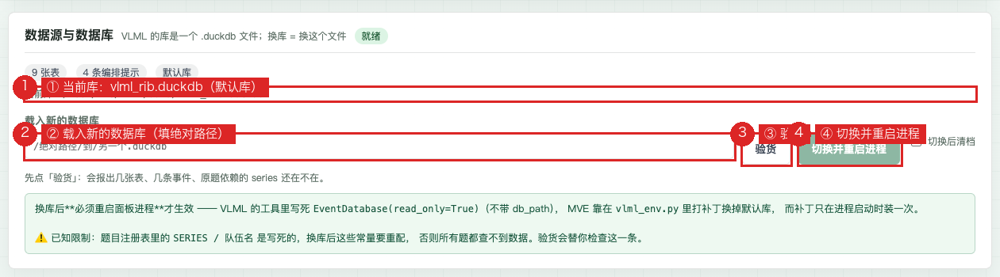
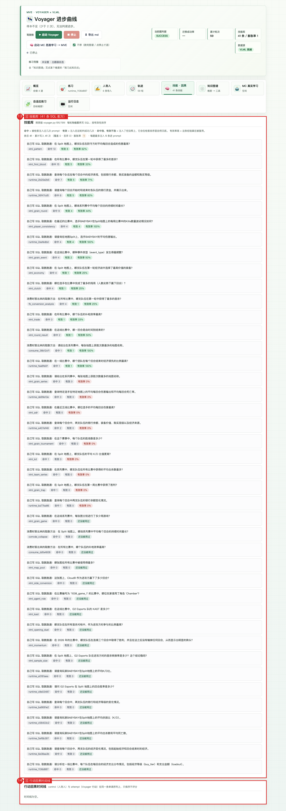

# MVE: Teaching Voyager to Orchestrate Data Retrieval on VLML

> 🏆 **Hackathon line** — [Nebius × NVIDIA Global AI Hackathon](https://nebiusglobalaihackathon.devpost.com/)
> (**Personal AI track**, submission deadline 2026-10-30). This repo is that contest's
> submission branch: the LLM backend is now **Nebius Token Factory + NVIDIA Nemotron**
> (the single egress point, `voyager_vlml/llm.py`), plus a new criterion-layer fix for
> "vacuum success".
> **The submission narrative and setup live in [HACKATHON.md](HACKATHON.md) (English)**;
> the main repo (development trunk) is at <https://github.com/Zxy876/voyager-vlml-mve>.
>
> **Live dashboard (hackathon demo, Nebius backend)**: https://43.161.203.50:8443/mve-hackathon/
> (self-signed certificate: the browser shows one "not secure" warning — choose "continue"; no login required)
> **Last updated**: 2026-10-14 (hackathon branch: Nebius backend + vacuum criterion fix + English materials)

---

## For Judges — English Quick Guide

MVE (Minimum Viable Egocentric) is an agent that answers your questions
against your own database — and, the part most demos skip, **learns a
reusable skill for every question it answers**, with success verified
against the database itself rather than another model's opinion. The full
submission narrative lives in **[HACKATHON.md](HACKATHON.md)** (English);
this section is the fastest path to running and testing the project.

**What it is, in one sentence:** Voyager's learning loop × database ground
truth — the agent writes its own questions and SQL, only counts a question
as "learned" when it truly retrieved data, stores every learned recipe in a
skill library, and reuses those recipes to answer you later. The memory
lives in the skill library, not in the model weights.

**Run it (5 minutes):**

```bash
pip install -r requirements.txt
cp .env.example mve/.env        # set NEBIUS_API_KEY (studio.nebius.ai)
python scripts/check_llm.py     # must print: gateway OK on Nebius + NVIDIA model
python mve/dashboard.py         # http://127.0.0.1:8777
python -m voyager_vlml.loop --rounds 5   # practice loop; skills start accumulating
```

**How to test the core claim** (the dashboard's "Human Import" panel):
ask *"On the 'Split' map, after G2 Esports wins the first blood, what
fraction of rounds do they win on average? Include the sample size."*
Expected answer, verified against the vendored rib.gg database: **100%,
sample size 7**, with an independent referee re-query and coverage 1.0.
Before the "vacuum success" fix (README ch. 21), this same question was
answered with a fake **0% / sample size 0** that passed every row-count
check — that bug, and its fix, are the heart of this submission.

**Key files:** `voyager_vlml/loop.py` (practice loop) ·
`voyager_vlml/consume.py` (consumption loop) ·
`voyager_vlml/agents/critic.py` (criterion: vacuum detection) ·
`voyager_vlml/llm.py` (the single LLM egress — Nebius Token Factory) ·
`mve/skill_store.py` (skill library) · `mve/dashboard.py` (nine panels) ·
`vlml/` (data layer: 21 tables, 46 insight SQL, 10 MCP tools) ·
`test_vacuum.py` (22 criterion unit tests) · `audit_skills.py` (skill audit).

*The remainder of this README is the project's deep documentation;*
*HACKATHON.md *is the evaluation-oriented entry point.*

---

A working prototype that answers one question: **when the "learner" is an agent
rather than a human, how much of a learning mechanism built for people can be
carried over as-is?**

- Data layer **VLML** (Valorant esports data: 21 native tables + 4 `ext` tables / 46 insight SQL / 10 MCP tools: `query_sql` + `get_database_info` + 8 report tools)
- The learning mechanism is taken from **Neko Study Companion** (N.E.K.O `study_companion`) — it ships a mature knowledge graph, mastery model, and scoring contract
- The learner under examination is a **Voyager**-style agent

In one line: **inherit the scenario, replace the pipeline, and write the
"agent as learner" layer from scratch.**

---

## 0. Understand it in thirty seconds

### Two pipelines, one capability set, two criteria

| | **Practice loop** (`voyager_vlml/loop.py`) | **Consumption pipeline** (`voyager_vlml/consume.py`) |
|---|---|---|
| Who asks | The milestone curriculum (it advances itself) | **A human writes one sentence they want answered** |
| What it does | Writes its own question → writes its own SQL → retrieves data | **Answers using capabilities it has already accumulated** (reuse a recipe → backfill entity values) |
| Success criterion | `success` = **did it actually get data out of the DB** (and not a vacuum value, see ch. 21) | Did it manage to answer (got real data + produced an answer) |
| Does it count toward a score | **No coverage, no mastery** | **This is where** coverage and mastery **start counting** |
| Who sees the score | Nobody (it reads the DB itself) | **Humans only**, never fed back into Voyager |

Both pipelines draw on the same capability set (SQL recipes in the skill library +
knowledge-graph nodes), but **the ledgers are separate**: practice is not scored,
consumption is. That is deliberate — VLML's ruler must not enter Voyager's feedback
loop, or it would learn to "please the referee" instead of "retrieve the data".

### Mastery = growth of the capability set, not a score

> User's definition (2026-10-13): **"I ask you one thing, Voyager answers it, and
> from then on that question is part of what it can do — that is mastery!"**

So mastery = `capability items mastered / total items that should be mastered`
(knowledge-graph nodes + items added during consumption), **fully separated from
coverage**: coverage is only a quality score for "how complete was this answer",
and plays no part in "does this question count as learned".

### Current snapshot (re-measured 2026-10-14 01:57; server-side counting restarted 10-13 19:24)

| Item | Value |
|---|---|
| Practice `run_log.jsonl` | 45 entries, 17 successful (new backend milestone curriculum) |
| Skill library | 19 entries, **all SQL recipes**; 6 of them repaired after the 10-14 vacuum audit (see ch. 21) |
| Graph progress | 17 milestones unlocked |
| Total capability items | 31 (the denominator of dashboard mastery, including seed questions and items added at runtime / during consumption) |
| Scaffold-removal exam / consumption log | Server side: 0 / 10 entries (the exam line has not been run on the server yet) |
| Data source | `vlml_rib.duckdb` (rib.gg; dashboard self-check reports 9 tables / 4 orchestration hints, default DB) |
| Dashboard | <https://43.161.203.50:8443/mve/> · 9 sections |

⚠️ **`success` on the practice loop does not mean "it learned it"**: it only means
"this round really retrieved data from the database". True level comes from the
scaffold-removal exam (`exam_log`) and the consumption pipeline (`coach_log`) —
neither has been run on the server yet (0 exam entries; 10 consumption log entries
including two re-runs of the same question).

---

## 1. Versus the old prototype: what is inherited, what is swapped, what is new

| Layer | Verdict | Content |
|---|---|---|
| Data source / usage scenario / problem background | **Inherited as-is** | Valorant match data, insight needs from a coach's point of view |
| How the problem is solved | **Swapped part** | The whole pipeline is now VLML: MCP connects the model straight to the database — if you want a number, query it; guessing is not allowed |
| Voyager learns first-hand, accumulates skills | **New (already rewritten once)** | See ch. 3: the old backend violated the design; rebuilt from original Voyager on 2026-10-12 |
| Human asks one thing → answer using accumulated capabilities | **New** | See ch. 4: consumption pipeline |
| Learning dashboard (measuring Voyager's progress) | **New** | The study-plugin dashboard was built for humans; here the learner is Voyager |

---

## 2. System overview

```
                    ┌──────── human (dashboard /mve/) ────────┐
                    │  overview · practice · human import      │
                    │  · trajectory · skills & causal          │
                    │  kg · MC real learning · adaptive · logs │
                    └───────────────┬──────────────────────────┘
                                    │ /api/state (4 s poll)
              ┌─────────────────────┴─────────────────────┐
              │                                           │
    ┌─────────▼──────────┐                    ┌───────────▼───────────┐
    │  practice loop.py   │                    │  consume.py            │
    │  curriculum picks   │                    │  human asks → find     │
    │  question generates │                    │  recipe                │
    │  action writes SQL  │                    │  backfill entities →   │
    │  critic verifies DB │                    │  retrieve              │
    │                     │                    │  VLML runs its own     │
    │                     │                    │  compare → narrative   │
    └─────────┬──────────┘                    └───────────┬───────────┘
              │                                           │
              └──────────────┬────────────────────────────┘
                             │
              ┌──────────────▼───────────────┐
              │  env/vlml_mcp.py (VLML MCP)  │  ← 10 tools, metrics only, no narrative
              │  DuckDB (vlml_vlr / vlml_rib)│
              └──────────────────────────────┘
```

### Directory map

| Path | What it is |
|---|---|
| `voyager_vlml/` | **Current backend.** The VLML isomorphic version of original Voyager's five steps (practice + consumption) |
| `voyager_vlml/agents/` | `curriculum` (topic selection) / `question` (generation) / `action` (SQL writing) / `critic` (success judgment) |
| `voyager_vlml/env/vlml_mcp.py` | Environment layer: wraps VLML's 10 MCP tools into `{ok, tool, rows, error, data}` |
| `voyager_vlml/control_primitives/` | SQL primitives (isomorphic replacement for the original `control_primitives/*.js`) |
| `voyager_vlml/consume.py` | **Consumption pipeline**: human asks one thing → answer with accumulated capabilities → score → enter capability library |
| `mve/` | Dashboard and data layer: `dashboard.py` (frontend + API) / `panel_data.py` (aggregation) / `coach.py` (legacy VLML explanation path) |
| `mve/topic_graph.py` | Graph nodes + mastery ledger (isomorphic to the study companion) |
| `mve/knowledge_graph.py` | VLML-side graph: 21 tables / 46 insights / fillable entity values |
| `mve/tasks.py` `planner.py` `exam.py` `learn.py` | Legacy question bank, question generator, scaffold-removal exam, learning-progress scheduling (the exam line still runs on this set) |
| `mve/vlml_source/` | Data fetching: `vlr_client` / `rib_client` / `ingest` |
| `voyager_original/` `study_companion/` | **Read-only references** (kept for forensics on the original; not distributed, not modified) |

---

## 3. The practice loop: five steps rebuilt on original Voyager

### Why it was rebuilt (the old backend violated a hard design constraint)

The old backend (frozen at `mve/voyager.py` + `mve/run_mve.py --llm`) had this
feedback skeleton:

```
Voyager's fact set → evaluate_vs_referee() compares it against the reference answer
                     computed by the VLML0 referee
                   → verdict / covered / missing / coverage / score all flow back
                     into Voyager's context
```

That amounts to **handing Voyager the answer key VLML produced and calling it feedback**.
By design, VLML's scoring is for human eyes only — the scoring authority must not enter
the learning loop, or it learns to "please the referee". On 2026-10-12 it was rebuilt
from original Voyager per the user's instruction, and the backend as a whole moved to
`voyager_vlml/`.

### Five-step isomorphism (user instruction verbatim → implementation)

| # | User instruction | Implementation |
|---|---|---|
| ① | Information carried by MC initialization → VLML isomorphic milestones | `agents/curriculum.py` |
| ② | `control_primitives` JS code → SQL primitives | `control_primitives/sql_primitives.py` |
| ③ | Install VLML MCP dependencies in the voyager environment (DB/RIB/VLGG) | `env/vlml_mcp.py` |
| ④ | Language inside the iterative-correction prompt → SQL | `agents/action.py` + `agents/critic.py` |
| ⑤ | Dashboard deferred (validate the backend loop first) | `loop.py` smoke test |

### MC fields → VLML isomorphism mapping (the skeleton of "isomorphism")

| Original Minecraft | VLML | Note |
|---|---|---|
| `biome` | Data source (rib / vlgg / DB) | What the world is |
| `nearby_blocks` | **Visible tables** (unlocked by progress tier) | What you can reach right now |
| `other_blocks` | Other tables already seen | — |
| `nearby_entities` | Fillable entity values (real value ranges in the DB) | Queried live, never hand-written; **⚠️ dashboard only, never into context** (see below) |
| `inventory` | Current entity anchor (series / team / map) | — |
| `chests` | **Learned skills** (reusable SQL recipes) | Skill library |
| `completed_tasks` | Unlocked milestones (graph nodes completed) | — |
| `failed_tasks` | Failed / skipped (**with reason**) | — |
| `"Mine 1 wood log"` | **VLML seed milestone** (trunk entry point, no prerequisites) | Hard-coded first question |
| — (new) | Milestone tree `seed / trunk / keystone` + random (table, column) minimal unit | Invented by MVE |

### The closed loop

```
curriculum.propose_next_task()     ← milestone tree picks the topic
                                     (seed → trunk, completed excluded)
        ↓
question.generate(topic)           ← LLM generates a question for the milestone node
                                     (question text only, no answer)
        ↓
skill_store.retrieve(tid, q)       ← **retrieve learned SQL recipes**
        ↓                            (same question first + cross-topic threshold)
                                   → stitched into the system prompt
                                     (as in original voyager.py:195/199)
action.solve(question, skills=...) ← LLM writes SQL → VLML MCP executes it
                                       failures iterate with a critique (max 3 rounds)
        ↓
critic.check_task_success()        ← success = did it actually get data from the DB
                                     (no comparison against a reference answer)
        ↓
skill_store.add(...) + mark_result ← store a new recipe only if it ran; injected
                                     recipes get one success/failure tick
        ↓
curriculum.update_exploration_progress()
                                   ← ran clean → unlock milestone + attach SQL skill pointer
                                     otherwise record failure/skip (with reason)
```

**Nowhere in this chain is there a VLML verdict, a coverage score, or a reference answer.**
Those live on the dashboard only.

### The skill-reuse chain: retrieve → inject → run → store + count (following the original four steps)

The original order (`voyager_original/voyager/voyager.py`):

| Step | Original | Line |
|---|---|---|
| ① retrieve | `skills = self.skill_manager.retrieve_skills(query=self.context)` | `:195` |
| ② inject | `system_message = action_agent.render_system_message(skills=skills)` | `:199` |
| ③ run | rollout (write code → execute → observe) | `:214+` |
| ④ store | `self.skill_manager.add_new_skill(info)` (**only on success**) | `:370` |

**Until now the practice loop only did ④**: `loop.py` only ever called
`skill_store.add()`; ①②③ were never done even once. The consequence is not
"the numbers look bad" — it is that **the skill library became a one-way
warehouse**: at one point 25 real SQL statements had been written into it on the
server and not one had ever been used; `hits` / `ok` were permanently 0, because
`mark_used()` (`skill_store.py:313`) **is only called after retrieve**.

Filled in per the original on 2026-10-13:

- `_retrieve_skills(tid, question)`: retrieve **before every trip that writes
  SQL** (same question first + cross-topic similarity threshold + validity
  weighting); anything retrieved gets `mark_used` (injected = one hit).
- `render_system_message(skills=[...])`: following the original `action.py:94`
  `+ skills`, recipes are appended after the data-retrieval primitives and land
  **in the system block**, so every iterative-correction round carries them.
- After success is judged, `mark_result(keys, success)`; `mark_result` only
  records successes, so "hits up, ok flat" = injected but unhelpful — and it
  naturally sinks in `retrieve()`'s `0.6*(ok/hits)` term.
- ⚠️ **Both paths that write SQL must retrieve**: the validation trip in
  `_generate_new_task` (after the seed curriculum is exhausted, **every** trip
  goes through this generation path) and the on-the-spot writing trip. The
  return value carries an extra `gen_keys` so that one injection for one
  question **records only one hit**.

**One necessary deviation** (the two sides store skills in different shapes; it
has to be spelled out):

> Original skills are **parameterized functions**
> (`async function mineBlock(bot, name, count)`), so reuse is naturally "call it
> with different arguments" — which is why the original writes no explanation at
> all when injecting. Our skills are a whole **SQL statement with hard-coded
> literals** (`WHERE team_name = 'NRG'`) — an instance, not a function. Without
> usage rules, the model copies last time's value verbatim and retrieves the
> previous question's team: it looks like reuse, but it is really memorizing
> the answer.

So the injection block carries five rules, two of them central: **the entity
literals in a recipe are the previous question's values and must be replaced with
the values this question points at** (user's words: backfill the current
question's entity values into the recipe); **if the quantity a recipe computes is
not the quantity being asked about, do not use it** (swapping the team name is
reuse; swapping the quantity is a category error).

**Measured (server, 2026-10-13 06:1x)**:

| | Before | After |
|---|---|---|
| Skill count | 25 | 31 |
| Total `hits` | **0** | **9** |
| Total `ok` | **0** | **5** |
| Round log | no reuse info | every row carries `reused_skills`; console prints `reused=N learned recipes` |

Skills that were reused: `runtime_b4b2bb78` 4 hits / 3 effective (75%),
`runtime_d049337b` 3 hits / 2 effective (67%); `vlml_side_conversion` 1 hit / 0
effective (that round failed with 0 rows) — **the effectiveness rate is finally
starting to discriminate**, which means `retrieve()`'s ranking actually reads it.

### Loop cadence: no stopping (isomorphic to the original `while True`)

Forensics: the main loop at `voyager_original/voyager/voyager.py:326` is
`while True`, and `--max-iterations` at `run_voyager_learn.py:55` defaults to
160. In the original there is **no such thing as "run N rounds and you're
done"**.

Previously `rounds` was treated as a hard cap and the dashboard hard-coded
`rounds:3` → a single launch ran only 3 questions and exited, so a 29-node
graph could never be finished. What a human saw was "it ended after three
rounds and never finished the graph".

| Beat | Current behavior | Implementation |
|---|---|---|
| Move to the next question | The automatic curriculum draws from **graph nodes** (seed → trunk → keystone) | `topic_graph.select_next` |
| Skip the current question | First attempt + retries ≥3 still failing → stale, switch question (**with reason**) | `MasteryStore.add_failure/add_skip` |
| End the whole run | **It does not end.** Keep skipping, no progress, still no end | `while True` in `run_rounds` |
| Nothing winnable in scope | **Keep generating new tasks**, and **validate them first** (fail validation → swap, no failure recorded) | `_generate_new_task` |
| Who can change the cadence | Only "stop" (SIGTERM) | `_install_stop_handler` |

Nodes generated at runtime are **persisted** to `mve/runtime_topics.json` (the
same file the consumption side uses for `consume_<hash8>`; here they are
registered as `runtime_<hash8>`) and loaded back into the in-memory graph at
startup. The cost of not persisting (measured 2026-10-13): 12 rounds produced 14
new recipes and recorded 34 completed entries, yet not a single graph node
survived — restart, exhausted again, re-validate the same batch of questions,
and "never plan the same thing twice" collapses.

Stopping is a **graceful stop**: after the signal it finishes the question in
hand, persists skills, then exits (the original's "exiting learn loop after
current task") — no hard kill.

```bash
python -m voyager_vlml.loop --rounds 0                      # never stop (default)
python -m voyager_vlml.loop --rounds 0 --max-iterations 60   # exit after 60 questions
python -m voyager_vlml.loop --rounds 1                       # just run one round for a look
python mve/pilot.py                                          # or the dashboard cockpit "Practice"
```

⚠️ Pinning a specific knowledge point (`--topic`) automatically degrades to 1
round: never stopping would just re-run **the same question** over and over, with
progress stuck at 0/1 forever. The dashboard's "Practice this knowledge point" is
that path, and the toggle locks itself off.

### Two state files: the loop writes its own, the dashboard writes only its own

| File | Who writes it | Content |
|---|---|---|
| `mve/loop_state.json` | **Only** `voyager_vlml/loop.py` (once per round) | round number, tool success/failure counts, rows retrieved, consecutive rounds with no evidence, rounds since the last milestone unlock |
| `mve/pilot_state.json` | **Only** `mve/pilot.py` | pid, who pressed stop, start/stop timestamps, exit code |

The dashboard is **read-only** on `loop_state.json`. Why they must be split:
written together they overwrite each other — the loop rewriting every round would
erase the `stop_requested` a human just set; the dashboard rewriting to show the
pid would erase the loop's just-landed "this round got no data".

### Environment feedback inventory: what goes into context, what goes to the dashboard only

Into the **runtime context** (Voyager decides its next step from these):

- Unlocked milestones (graph nodes completed — boolean, **no scores**)
- Learned skills (reusable SQL recipes)
- Task failure (with reason), task skip (with reason)
- The environment feedback itself: whether the tool call succeeded or failed, how
  many rows came back this time, what changed in the graph because of this round

**Dashboard only** (never into context, via `scene_context.panel_only()`):

- Which values for the current entity actually exist in the DB
  (`series / team / map ∈ {…}`)
- The verdict VLML produced by running once: score / coverage / verdict

Both for the same reason: that is not feedback, it is a **ruler** (the latter) or a
**candidate answer list** (the former). Putting it in context would pull its focus
from "get this question's retrieval working" to "game the ruler / enumerate values
until something matches".

For the same reason, the threshold for moving up a scene tier (base layer → ext
layer) is **unlocked milestones ≥ 3** (`TIER_EXT_UNLOCKS`), not mastery ≥ 0.8 —
mastery is a scoring result and cannot serve as a disclosure condition.

### Consecutive rounds with no evidence: it keeps running, but you must be able to tell "hasn't learned it" from "the pipeline is broken"

A loop that never stops cannot fall back on "stop on failure", so the loop writes
each round's reason into the heartbeat, and the dashboard splits it by
`no_evidence_kind` into three visible diagnoses:

| kind | Meaning | What to go fix |
|---|---|---|
| `linkage` | Not one tool call succeeded, and the error is **infrastructural** (can't open the DB / tool not loaded / module missing) | **The pipeline is broken**: is the DB there, are the VLML tools installed, which DB does `db_config.json` point at. Fix config/dependencies — nothing to do with "it hasn't learned it" |
| `sql_error` | The tool **did run**, and reported a Parser / Binder error | **Its** problem: wrong SQL, wrong column name, guessed the value type wrong. Check which SQL errored in the log |
| `empty` | The SQL ran but returned 0 rows | **Its** problem: filter too tight, or the question asks about data that isn't in this DB. Look at the WHERE it wrote |
| `unproven` | Got data but critic judged it not valid evidence | It probably hit the wrong object or an empty shell table |

⚠️ The `sql_error` bucket was added later: at first every "badly written SQL" was
filed under `linkage`, so the dashboard told people to check "is the DB there, are
the tools installed" — sending them to a place that was never wrong. Mis-triaging
costs as much as not triaging at all.

At ≥3 consecutive rounds the dashboard shows an alert bar; **the loop does not stop
because of it** (by design, only stop can change the cadence).

---

## 4. Consumption pipeline: a human asks one thing, Voyager answers with what it has accumulated

> User instruction (2026-10-13): "The learning part is done now, so we have to do the
> consumption part too — that's human import; write one sentence you want to ask. Voyager
> will answer using capabilities it has already accumulated; and underneath, VLML's
> parsing (which tools it called, which facts it got) is disclosed as before.
> **This is the best place to start computing coverage and mastery**"

### Seven-step pipeline

```
① topic routing (find the scoring points) → same-question check
                                     can't route → derive / generate a new question;
                                     a wrong ruler must be blocked
② fix the scoring points (dimension names)   set before retrieval, **both sides share one copy**
③ find a learned recipe                      search the skill library
                                            (the two ID systems don't talk; literal matching)
④ retrieve: reuse recipe → backfill entity values
                                     reuse fails → write live, honestly flag reused=False
⑤ VLML runs its own pass (retrieval only, no tidying)   in parallel with Voyager's path
⑥ compare the two sides' methods and moves → score       agreement = coverage
⑦ narrative insight → into the capability library → mastery
```

### 4.1 What gets reused is the **computation**, not the number

A recipe is SQL learned earlier. **Reuse = backfilling the entity values in the current
sentence into the recipe's computation** (swap team / map / series); the number has to be
recomputed.

> User's words: "Don't count 'remembering the number' as success — start storing the skill
> from the process of using a method to pull the number out.
> **Backfill doesn't exist; there is only faster computation**"

When the DB holds no usable recipe, it degrades to writing SQL live and **honestly labels
it `reused=False`** ("this question isn't learned yet, it's being done on the spot" — no
pretending it used a capability).

⚠️ Before backfilling, judge one thing first: **is the quantity the recipe computes the
same quantity this sentence is asking about?** If not, don't execute it — write it live.
Measured the hard way: asked about "collapse" (needs consecutive losses), the DB only had a
K/D recipe, and the model still filled Cloud9 in, produced a K/D query, and declared it
"reused the recipe" — a wrong number you can still see, **but a wrong quantity is a wrong
direction, far more dangerous than an error**.

### 4.2 Mastery = growth of the capability set (the criterion is "did it answer")

```
Finished answering (tool went through + got data + produced an answer)
    → mark_completed (this question is marked as mastered)
    → this round's retrieval SQL is stored as a reusable recipe in the skill library
```

**The criterion is independent of coverage**: whether coverage is computed at all, and
what it comes out to, never affects "does this question enter the capability library".
Otherwise you'd be stuffing VLML's scoring back into the learning judgment.

⚠️ When it can't route to an existing question it **still enters the capability library**:
register a stable capability item `consume_<hash8>` keyed on the md5 of the question
(persisted to `mve/runtime_topics.json`). **Failing to route ≠ failing to answer** —
measured: 1334 rows retrieved, answer complete, yet because it didn't route to the legacy
question bank it was judged "didn't answer, not added to the capability library".
The denominator rises by 1 in sync (graph nodes + consumption-phase items), otherwise
mastery would be inflated past 100%.

### 4.2.1 The learning curve is wired to the **consumption capability side**: practice does not count (2026-10-14)

> User (2026-10-14): "Wire the learning-curve line to the consumption capability side; the original voyager's practice rounds don't count."

**Original forensics** (`voyager_original/voyager/agents/curriculum.py`):

| Line | Original | Meaning |
|---|---|---|
| `:135` | `return len(self.completed_tasks)` | the learning curve = **size of the capability set**, not a score |
| `:339` | `self.completed_tasks.append(task)` (inside the success branch) | appended **only on success**, failures don't count |
| — | the word "exam" appears nowhere in the file | the original has no exam line; the learning curve *is* the capability set |

**The trap we hit (a real server run printed 129%)**:

```
mastered · cumulative 58 / 45 questions (mastery 129%)   ← numerator bigger than denominator
```

The root cause is not arithmetic, it is **semantic crowding**: the `completed` bit on
`MasteryStore` originally carried exactly one meaning — "this node has been planned,
don't let `select_next` plan it again" — a **deduplication bit**. But the consumption
pipeline later **borrowed** it to mean "mastered", so two meanings crowded onto the same
boolean, written by three parties:

| Writer | Location | What setting this bit means to it |
|---|---|---|
| Practice loop | `voyager_vlml/agents/curriculum.py:296` | ran clean → don't plan this question again |
| Legacy backend (frozen) | `mve/run_mve.py:463` | `ev.success` → don't plan this question again |
| **Consumption pipeline** | `voyager_vlml/consume.py` | a human asked and it answered → **I can do this question** |

The numerator counts **all** completed entries in `MasteryStore` (58, including the
practice loop's 29 `runtime_*`); the denominator counts "graph 29 + `runtime_topics.json`
16" — and that file is **shared** by the practice loop and the consumption pipeline, and
12 of those 16 entries have `source="practice"`. The two sets simply aren't the same kind
of thing.

**The fix (three places)**:

1. `mark_completed(tid, *, source=...)` persists `completed_source`; the three writers pass
   `practice` / `practice` / `consume` respectively (one-way upgrade practice→consume, so a
   fact of mastery is never overwritten by practice). The dedup bit is still the dedup bit,
   but from now on it is **auditable**.
2. The consumption pipeline keeps its own ledger, `_consume_book()`: it reads the
   deduplicated `topic_id`s from `coach_log.jsonl` where `mode=voyager_consume` and
   `mastered` — the exact isomorphic counterpart of the original's `completed_tasks`
   (**the learning loop's own ledger, not the globally shared mastery file**). The
   denominator `_ability_universe()` = graph nodes ∪ **consumption-side** registered
   items, dropping the practice loop's 12.
3. `_consume_curve()` **recomputes** `mastered_total` on the backend instead of trusting the
   stale figure baked into the record — when a definition changes, the number inside
   historical records does not update itself (old records say 58/45; plotting them directly
   pins to the ceiling and crosses 100%).

**Measured comparison (server 43.161.203.50)**:

| | Old definition | New definition |
|---|---|---|
| Numerator | 58 (all completed, incl. 29 from practice) | **2** (deduped questions answered on the consumption side) |
| Denominator | 45 (graph 29 + runtime_topics 16, incl. 12 from practice) | **34** (graph 29 + 5 registered on the consumption side) |
| Mastery | **129%** ❌ | **6%** ✅ |

**Curve behavior (4 real consumption runs)** — the y axis is **how many questions it can do
cumulatively** (plotted as an absolute count, following the original `:135`, not a
percentage; the moment you plot a percentage, the reading depends on definitional arguments
like "which questions belong in the denominator"):

| # | Question | Answered | Cumulative mastered | Recipe reused |
|---|---|---|---|---|
| 1 | On the Split map, which team has the highest win rate? | ✓ | 1 / 34 | ✓ |
| 2 | On the Ascent map, which team has the highest win rate? | ✓ | 2 / 34 | ✓ |
| 3 | How many rounds did LOUD play in total across these matches? | ✗ | **2** / 34 | ✗ |
| 4 | Which team has the highest pistol-round win rate? | ✗ | **2** / 34 | ✓ |

Runs 3 and 4 failed, and the cumulative count **stayed flat at 2** — that is precisely
the shape `:339`'s "append only on success" produces: **failures don't count, so the curve
is monotonically non-decreasing**.

⚠️ **Honest limitation**: 29 curriculum questions (graph nodes) sit in the denominator, and
it only grows when a human actually asks one through the consumption pipeline and gets an
answer. So 6% is not "it only knows 6%", it is "a human has only asked 2 questions". By the
user's criterion that is exactly right — practice isn't scored, capability only grows from the
consumption side — but it means **mastery only moves when a human asks**; to see a full board
you have to walk the curriculum questions one by one.

### 4.3 Scoring = **directly comparing the two sides' methods and moves**

> User (2026-10-13): "Tidying facts is the LLM's job anyway — on the consumption side,
> just compare voyager's and VLML's methods and moves directly, compute mastery and the
> curve, put it in the capability library, then let the LLM produce the narrative insight.
> That's all."

**Old scoring (retired)**: each side tidies its result into
`{subject, dimension, value}` → compare by `(subject, dimension)` key → coverage.
The fragility sits in the "tidying" step: when the answer is a table it cannot be
squeezed into single-value facts → both sides hand in blank papers → coverage
collapses and the answer comes back empty (**measured: 85 rows retrieved, yet the
panel said "Voyager can't answer"**).

**New scoring**: lay out both sides' SQL and the rows they got, and let the LLM judge —
is it the same metric definition? Does Voyager's path have a hard flaw (division by
zero / wrong column name / wrong granularity / inverted direction)? **Agreement is
coverage.** LLMs are naturally good at this kind of semantic comparison; there is no
need to flatten results into key-values first.

So the referee side **retrieves only, never tidies** (`_referee_observations`), saving
the two calls most likely to hand in blank papers.

### 4.4 Traps hit in real runs (every one has evidence, none is inference)

| Trap | Measured evidence | Fix |
|---|---|---|
| **Empty tables in the schema** | In the rib DB all `agg_*` are 0 rows; the data lives in `ext_player_round_stats` (2850 rows). The model judged the `agg` table names more "official" and queried them → 0 rows → reported "got no data" | `schema_block` carries **the row count of every table**, empty tables explicitly say "querying this only yields 0 rows"; tables with data sort first to survive truncation |
| **Answered it but couldn't enter the capability library** | 1334 rows + a complete answer, dashboard showed "didn't answer, not added" | Register a capability item keyed on the question hash; failing to route still enters |
| **Both sides 0 rows scored 100%** ⚠️ most dangerous | Cloud9/Corrode have no data in the current DB, both sides got 0 rows and the SQL looked identical → judged "definition consistent, 100%" | **Either side 0 rows → no scoring.** Scoring it would hand out full marks for "neither retrieved anything", more dangerous than an error |
| **`voyager_sound` was wrongfully blamed** | The referee itself added up deaths and computed K/D; Voyager was right yet was judged "has a hard flaw" (the reason field even said "no hard flaw") | Force the judgment order (look at Voyager's own SQL first) + consistency fallback |
| **Narrative truncated by token limit** | Given 1334 rows to talk about, it spread out map by map and the output froze mid-sentence | Cap at 250 words + forbid row-by-row listing |
| **Different definitions shown as a red 0%** | Misleadingly read as "it isn't capable", when in fact the referee had drifted | New `judged` field: different definitions = "not actually judged", shown as a grey badge |

### 4.5 How to read it on the dashboard

- **Human Import** section: write one sentence → hand it to Voyager to answer (runs
  1–3 minutes in the background, with a progress bar)
- The result **lands in import history** (not just a one-off receipt that vanishes on
  refresh after a background run)
- **Learning curve · consumption capability side** (placed **first on the overview
  page**, not only on the Human Import page): main curve = **how many** questions it
  can do cumulatively (y axis is an absolute count, following the original
  `curriculum.py:135` `len(completed_tasks)`), secondary line = agreement (dashed).
  **Practice doesn't count**: on the failed runs the curve goes **flat**, it does not
  turn downward — that is what "learning rounds don't count" looks like on a chart.
  The exam line (scaffold-removal re-test) sits further down (see 4.2.1)
- **Side-by-side comparison detail** table: for each consumption run, Voyager rows /
  VLML rows / agreement / is it the same quantity / the criterion text verbatim

```bash
python -m voyager_vlml.consume "What is the average number of kills per role in each round?"
```

---

## 5. Data contract: Voyager's output is a **fact set**, not a paragraph

```jsonc
{ "subject":   {"series": "2843069", "map": "Corrode", "team": "Cloud9"},  // cross-key dict
  "dimension": "key_metrics.team.consistency.kast.num",                    // metric name, dot-nestable
  "value": 109, "unit": "count",
  "base":  109,                                                            // denominator, required for percentages
  "scope":  {"rounds": 59, "confidence": "Strong"},
  "source": {"tool": "match_analysis_report", "section": "key_metrics"} }
```

| Design point | Why | Implementation |
|---|---|---|
| `subject` is a **cross-key dict**, not a string path | Multi-dimensional crossings like `mitch on Skye` or `Corrode R4` cannot be built by string concatenation | `loop_core.norm_subject()` normalizes strings into dicts too |
| `base` is mandatory and **participates in scoring** | 67% (16/24) and 67% (2/3) carry the same number but are not the same fact | `base < min_base` is judged missing outright — **a correct value still doesn't count** |
| Survives both extremes | `query_sql` with arbitrary SQL → one row, one column, one fact; report tools aggregate → one dimension per key | JOIN / CASE / window-derived columns are all fine |
| diff unit = `(subject, dimension)` pair | Compares **coverage** against the rubric, not path identity — different routes to the same place aren't penalized | `loop_core.fact_key()` |

**Judgment order (the deterministic layer runs first, no LLM call)**:

```
0. tool-call gate —— not one tool call succeeded → the whole round is judged "no evidence"   ← anti-fabrication
1. base gate      —— denominator too small; a correct value still doesn't count
2. (subject, dimension) hit
3. value tolerance comparison —— tolerance is read only from the server-side answer_spec
points that can't be judged → unjudgeable: neither silently counted right nor silently counted wrong
```

The four `confidence` tiers (`n≥100 Strong / 50-99 Moderate / 20-49 Weak / <20 Insufficient`)
are **computed directly from `base`**, live in the deterministic layer, and never ask
the model.

### Where the narrative lives, and how it declares itself non-comparable

| Location | Marker |
|---|---|
| Explanation output area (VLML + its LLM output) | `comparable: false` |
| The narrative block at the end of Voyager's answer sheet | `comparable: false` |
| Question text produced by the question generator | What participates in comparison is key_points, not the question text |

Double marking: machine-readable `{"narrative": {"text": "...", "comparable": false}}`
+ a human-readable "not part of comparison" label on the dashboard. VLML drew this
boundary itself (`README.md:97`: All reports return metrics and evidence only. LLMs
should generate insights.)

---

## 6. Intent is an object, not free text

The question generator produces an **object**:
`question + answer + key_points[] + rubric{scoring point: weight} + solution_steps[] +
difficulty(1-5) + topic + target_topic_id`.

**Human import and generator output are not the same structure**, and one boolean is what
splits them — the study companion calls it `validated_target`
(`practice_outcome.py:53-67`):

| | Human import | Generator output |
|---|---|---|
| `validated_target` | **false** | true |
| Counts toward mastery | **No** | Yes |

### Causal timeline of actions

Facts of every kind go into **one monotonically increasing timeline**, which guarantees
order and produces no score (isomorphic to the study companion's `root_fact_seq` in
`docs/cognition-engine-stage-doc.md:80`):

| fact kind | Who produces it | Enters causal | Enters mastery |
|---|---|---|---|
| `control` (human import) | Human | ✅ | ❌ |
| `attempt` (Voyager's orchestration and fact set) | Voyager | ✅ | ✅ |
| `referee` (referee verdict) | VLML0 | ✅ | ✅ |
| `narrative` (narrative output) | LLM | ✅ | ❌ |

Without this line, a human import would amount to nothing having happened. The question
generator reads **both** the timeline (causality) and mastery (scoring).

---

## 7. Three granularity tiers = three depths of VLML expansion

| Tier | VLML expands down to | Dashboard location | Study-companion counterpart |
|---|---|---|---|
| Coarsest | 21 tables / 46 insights / 146 tool segments = **212 fact nodes** | Knowledge graph | Knowledge graph |
| Middle | Expanded to records, computing mastery per grouped class | Practice scope | Practice scope detail |
| Finest | Fully expanded, judging every answer Voyager gives per combination | Overview / Trajectory | Scoring |

The key property of the graph: **the 212 facts are a full set that exists prior to any
question** (queried live from VLML, not derived from a rubric) — not a projection derived
from the questions.

---

## 8. The question generator: how adaptive is it really

### Conclusion: the question text was once hard-coded, but **the difficulty-gradient layer is running**, and new questions can be generated automatically

The 6 questions in `tasks.py` are hard-coded (`question` / `rubric` / `answer_spec`);
`difficulty` is a **seed difficulty**, not the final difficulty. The question generator
(`planner.py`) is adaptive about **which question to pick** (priority chain + cooldown gate
+ stagnation graduation), and `difficulty.select()` is adaptive about **what difficulty to
generate at and how much scaffold to give**.

### Reconciliation with the study companion

| Study companion | MVE | Note |
|---|---|---|
| `select_practice_selection` priority chain retry>due>weak>blocked>recommended>default | **Inherited** | each entry carries reason + explanation |
| 82 seed knowledge points | **Replaced** | 6 hard-coded questions + auto-generated ones from `question_gen` |
| `difficulty_policy.select` computing difficulty 2/3/4 | **New (isomorphic dimension swap)** | see below |
| Questions generated per (knowledge point, difficulty) | **Done** | `question_gen.py` |

### Auto-generated questions: what gets generated is a **recipe**, not an answer

> The previous version said "not doing this — LLM-generated questions have no
> `answer_spec`, so the referee has no way to compute the reference answer".
> **That judgment was wrong.** The error was equating "you can't trust the answer value a
> model gives you" with "you can't let a model generate questions".

The correct approach: have the LLM produce an **executable data-retrieval recipe** (SQL,
or tool + arguments + value path). The recipe is executable → the referee runs it once and
gets the true value from VLML. Measured:

```
[referee VLML0] series=2843069/team=Cloud9/map=Lotus · map_win_rate = 45.8 (base=24)
```

#### Four-stage closed loop (following the study companion's `question_generate` + `question_validate`)

| # | Study companion | MVE |
|---|---|---|
| 1 | Question type fixed by the server | `_dim_specs()` definitions fixed by the server, and **enumerates the dimensions** for the model to choose from |
| 2 | LLM writes question text + answer | `propose()` writes question text + **retrieval recipe** (answer values forbidden — including one voids it) |
| 3 | A second LLM judges three booleans | **Deterministic validation**: does it run / is the value non-empty / is the dimension right / is it a duplicate |
| 4 | Forced correction | `enforce()` force-corrects dimension, tool, arguments, percent, denominator |

Step 3 is where MVE is **stronger** than the study companion: there, "is the answer
supported" is another model's opinion; here it is a data fact — run it once and you know.

#### The seven validation gates (each one replayable)

| Gate | What it judges | What it has actually caught |
|---|---|---|
| Is the dimension declared server-side | No inventing definitions | Filling in the **tool name** `pattern_detection_report` as a dimension |
| Is the question text related to the dimension definition | The study companion's `relevant` | Asking for "force-buy round win rate" but filling in `pattern_confidence` |
| Does it duplicate an existing (subject, dimension) | No duplicate questions | `pistol_win_rate` × {series,team} already exists |
| Do two scoring points inside one question duplicate | Two points written as the same query | The two points' SQL is byte-identical |
| Does a percentage definition supply a denominator | Asking for a win rate but fetching a count | Only `pistol.num`=3 given; true value 3/6=50% |
| Is the computed value a legal percentage | 0–100 | — |
| Does a count dimension exceed its ceiling | ≤ total rounds in the match, 59 | `SUM(round_number)`=145 treated as "how many rounds played" |

#### Failures are fed back, as "what's wrong + how to fix it"

The study companion only stuffs `validation_failure` into the feedback. MVE adds one more
sentence about **how to fix it** — reporting only the symptom could not get it changed in
three rounds of real runs (the model would commit the same mistake a different way):

```
Fix: these are not `rounds` columns in your SQL: team_name. The rounds table has no
     team_name column; filter teams with winning_team_name
```

⚠️ **Honest success rate**: on the **tool path**, generated questions are written correctly
on the first try; on the **SQL path**, roughly one third get through. The seven gates
block and feed back, but cases that can't be fixed in three rounds do exist — that is a
model-capability issue, not a pipeline issue.

### How the gradient lands: the isomorphism swapped one dimension

```
Study companion: same knowledge point, difficulty 2 → 3 → 4 (the question gets harder)
MVE           : same question, scaffold full → partial → none
                (the question stays; the support is withdrawn)
```

The scaffold only changes **how much the prompt gives**, not `answer_spec` — so the scoring
points stay put and the referee still judges.

| Tier | What it gives |
|---|---|
| `full` | ★ declared definition path + critic fed back with real candidate paths + the focused structure doc |
| `partial` | The focused structure doc; no ★, no candidates |
| `none` | No focus, no ★, no candidates |

A/B (same question, same input, through a clean channel with no skill-library reuse):

| Tier | `kast_pct` | `kd_ratio` |
|---|---|---|
| `full` | `{109/109}` ✅ | 1.24 ✅ |
| `partial` | 1.0 ❌ | 1.0 ❌ |
| `none` | 100.0 (wrong shape) | 1.0 ❌ |

→ **The scaffold is not decoration**: remove it and you are back to the old illness of
"applying the num/denom pattern to a scalar".

One more hard constraint: **if the DB has no reusable program, don't withdraw the
scaffold** — withdrawing it doesn't raise the difficulty, it just makes it re-commit the
old mistake.

### Isomorphically generated test questions: `mve/gen_testset.py`

Per the meeting notes: "Test questions are all generated isomorphically from projects that
already ran end-to-end, replacing only data such as series IDs and player names; the
question logic is rigorous, with no unreasonable generalization demands."

```
python mve/gen_testset.py --topic fb_conversion_analysis   # generate one
python mve/gen_testset.py --all                            # all questions
```

Method (**deterministic, no model involved**):

1. Take the source question's (already working) logic skeleton = rubric scoring points +
   `answer_spec` (server-side private)
2. Query the target entity live from the current DB: a new series (most rounds and ≠
   source), plus that series' team / map
3. Isomorphically substitute subject / question / the entity values inside SQL quotes /
   `tool_args` — **swap only data, never logic**
4. Run the VLML0 referee check: a scoring point holds only if its dimension produces a
   value in the reference-answer facts

Measured (vlr/rib, both DBs): **7/7 all hold** (series=1067, dimension coverage 100%).

---

## 9. Human import → generate explanation → influence question generation (reconciled against the study companion)

### How the study companion runs this chain

1. Human enters text → `study_explain_text`
2. LLM generates an explanation (`concept_explain`)
3. The imported **material** is mapped by `MaterialTopicMapper` onto knowledge points
   that **already exist** in the graph (mapping to a non-existent topic is always rejected)
4. Those knowledge points become the practice scope → the generator produces questions
   by `weak_topic`
5. When routing fails: prompt the human to pick a knowledge point in the graph

Note step 3: **the study companion doesn't conjure new knowledge points out of text
either — it maps onto existing ones.**

### MVE's counterpart

| Stage | Study companion | MVE | Status |
|---|---|---|---|
| Enter text | `study_explain_text` | `coach.explain()` | ✅ isomorphic |
| Generate explanation | `concept_explain` | VLML retrieval + `narrator` explanation | ✅ isomorphic |
| Explanation written to record | learning record | `causal_timeline` CONTROL fact | ✅ isomorphic |
| Route to an existing knowledge point | `MaterialTopicMapper` | `infer_topic()` | ✅ isomorphic |
| Records influence question generation | practice_scope / weak_topic | planner `human_focus` | ✅ wired |
| **When routing fails** | Prompt the human to pick a knowledge point | Generate a new question (one more route than the study companion) | ✅ added |

### Adoption criterion: not "does the graph have a dimension with the same name"

v1's approach was "if it doesn't match, add a dimension node to the graph", which real
runs overturned — the very basis for building the graph was wrong:

- The `dimension` layer has only 15 nodes, all reverse-derived from `TASKS[].rubric`
  ("only what has been asked enters the graph"), so a new direction a human asks about
  **naturally has no landing spot** on this layer
- Whereas the `insight` layer (VLML's 46 insight SQL, each declaring which tables it
  reads) has **complete coverage**
- And the most damaging measured fact: **there is not a single edge between `dim` and
  `insight`**. It's not missing nodes — it's missing edges

So v2's criterion (`knowledge_graph.coverage_of`) becomes:

```
the question a human asks → VLML really runs one retrieval → get the real SQL / tool / tables
        → look up which insights cover these tables
        → hit = "VLML can finish this job with the tool set covered inside those tables"
        → adopt
```

The write path is **create edges, not nodes** (`link_import`; all three edge types carry
`origin=observed`):

| Edge | Meaning |
|---|---|
| `insight:I --application--> table:T` | this insight was actually applied once on this table |
| `tool:X --composes--> insight:I` | this tool really did use this insight this time |
| `insight:A --co_occurs--> insight:B` | the same question requires these two insights together |

Two engineering constraints, both forced by real runs:

1. **Rate limiting is mandatory**: asking once about "round win rate" touches
   `rounds + games`, and 36 of the 46 insights read them — without limiting, one import
   lands **168 edges**. Changed to take the **minimum covering set** (top 3; 168 → 12)
2. **Coverage must be recomputed at merge time**: after the graph is rebuilt, old records
   automatically upgrade to the new criterion level (recomputing is free)

### The graph's four-layer organization (copied from the study companion)

| Study companion | MVE mapping |
|---|---|
| **stage** (school stage = gradient) | **Tool-set gradient**: `raw` → `agg` → `insight` → `tool` |
| **subject** (discipline) | **Entity domain**: player / map / team / series, fillable with concrete values |
| **chapter** | **Theme domain**: first blood / economy / pistol rounds / losing streaks / site executes / pattern detection |
| **topic** (knowledge point) | Dimension nodes = VLML's modeling of the data |

Two traps:

1. **Semantic mismatch (fixed)**: `chapter` previously stored `LAYER_LABEL`
   (trunk tables / derived tables), but that is actually the **gradient** — it was
   occupying the study companion's `stage` slot
2. **Discipline values must be queried live**: `entity_catalog.py` connects to the DB,
   queries the actual values and persists them; the graph only reads the cache. A
   hand-written list goes entirely wrong the moment you switch databases

### ⚠️ A course correction on 2026-10-08: series IDs / team names are **not** "disciplines"

We went to the study companion for forensics, and the criticism holds
(`entry_tutor_question_entries.py:1043-1051`): **subject / stage / chapter / unit /
course_family are all filter parameters of `list_topics`, not hierarchical attributes
carried on a knowledge point.** The knowledge-point library is one shared copy; changing
a value only changes "which ones get filtered out to practice" — the knowledge points and
tool set themselves are **not rebuilt**.

| MVE's thing | Study-companion counterpart | Nature |
|---|---|---|
| Series ID | `course_family` (which textbook set) | Scope **filter parameter** |
| Concrete values of team / player / map | `entity` in `_semantic_routing.py:149` | Runtime retrieval parameter, **does not enter the knowledge structure** |
| Which DB is connected | No counterpart in the study companion | MVE's own `data_source` |

Measured after switching to the vlr.gg DB: **dimensions still 15, tools still 9** (not
one changed) — only the fillable values grew from 2/3/1 to **12 teams / 7 maps / 60
players / 8 series**.

⚠️ **Deliberately different from the study companion**: its disciplines are a preset
enumeration (allowlist validation), MVE **keeps no allowlist** — data sources change, and a
preset enumeration inevitably rots. The price is that if a human fills in a value that has
no data in the DB, the question produces no number, and the validation gate blocks it (it
won't slip into the question bank).

### Honest limitations

- **If coverage can't reach it, don't adopt it**: return `adopted=False` honestly, create no
  node, and generate no questions from it
- **Dimensions of runtime questions create no nodes**: first resolve against existing
  dimensions; if it can't be resolved, **create no node** — only register a candidate
  pending review (following the study companion's `knowledge_tracker.py:1555`)
- **The validation gate is still a hard threshold**: measured — the same import had its
  first 2/2 blocked entirely by the "question text related to dimension" gate

---

## 10. Knowledge graph: writing VLML's modeling declarations into nodes and persisting them

In the study companion, each of the 457 knowledge points carries 19 fields of its own
(difficulty, question type, prerequisites, typical mistakes, …); the question generator
reads the node declaration to fix the question type and metric definition, and the model
only writes the question text. On the MVE side, `pk` was at one point an empty array and
columns had names but no meaning.

In VLML the same-layer "author declaration" was there all along — four modeling documents
under `database/`:

| Document | What it provides |
|---|---|
| `DATA_MODEL.md` | Each table's `**Grain:**` + `**Use cases:**`; trunk lineage |
| `DERIVED_TABLES.md` | Grain / upstream / key columns / example queries for the 7 derived tables |
| `metadata/column_definitions.yaml` | Column-level definitions (141 hand-written lines) |
| `DATA_DICTIONARY.json` | Primary keys / column types / flags / **metric formulas** |

`vlml_schema.model_specs()` parses all four (**reads files, works even with the DB
disconnected**), writes the results into table nodes and dimension nodes, and persists
them via `save()`.

### The declarations are genuinely consumed (three consumption points)

1. **The generator no longer counts difficulty its own way**: difficulty lives on the node
   (`map_fb_conv=1`, `max_losing_streak=4`)
2. **When writing SQL it knows what each column is**:
   `column meaning: fb_team_won=Conversion flag (1/0)`. Previously it was given only
   column names — so the model wrote `fb_player` as `player_name`, and even when the
   critique listed the real names every round it kept inventing them.
   **Giving it the real name isn't enough; it needs the meaning.**
3. **Units**: dimension nodes carry `unit: %`, and the prompt states explicitly "a
   percentage, not a decimal" (the model has submitted both 0.55 and 55)

### Three traps (all of them hit)

- **Persistence = cache expiry**: `_stale()` only compared the tasks.py fingerprint. Added
  `SCHEMA_VERSION` and a modeling-document fingerprint, making three criteria: format
  version / question fingerprint / modeling fingerprint
- **Difficulty must be counted from the full SQL**: `semantics` is only the SELECT
  projection — there is no `GROUP BY` in it
- **`_s` false positive**: "losing_**s**treak" in `max_losing_streak` contains `_s`, so
  checking time first mislabeled it as "seconds". Criterion order: losing streaks / rounds
  first, then time

---

## 11. Criterion layer vs mastery layer: one clean cut

Following original Voyager, **`success` is the criterion**.
`critic.check_task_success` is boolean self-verification: the task goal was really achieved
in the environment = success; 95% achieved = **not achieved**.

| Layer | Owner | What it reads | Purpose |
|---|---|---|---|
| **Criterion layer** | Voyager (it is learning) | `ev.success` boolean | **Store skill / stop repeating the question / advance to the next question / transfer exam** — it alone is authoritative |
| **Mastery layer** | Study companion (measuring ruler) | mastery_v2 five levels + coverage | Only measures "how well it performs unaided against a public DB"; **does not decide what to practice** |

The learning-phase criterion (decided by the user on 2026-10-08):

```
task done = orchestration ran (there was a successful tool call)
          + got data (facts non-empty)
          + no crash (no tool error)
```

**It does not require matching VLML's process, and it does not compute coverage points** —
that is Voyager's while-learning metric.

---

## 12. Provenance of numbers and formulas (ABA)

Principle: **every formula and number that appears in MVE is either copied from an
upstream project (with the source given), or a flagged isomorphic dimension swap (with the
original item and the reason), or honestly labeled "custom/approximate". Not one of them
was made up on the spot.**

### A. Following original Voyager (MineDojo/Voyager)

| MVE's value/mechanism | Original source | Note |
|---|---|---|
| `RETRIEVAL_TOP_K = 5` | `skill.py:25` `retrieval_top_k=5` | copied verbatim |
| Skill primary key + overwrite on same name | `skill.py:53-55` "already exists. Rewriting!" | copied (overwrite the old version, don't accumulate forever) |
| Retrieval hit → exec directly | `skill.py:67-75` takes code and executes it | **MVE self-flagged approximation**: no vector store; literal Jaccard, not Chroma semantic vectors |
| Persist skill only on success | `voyager.py` main loop `if info["success"]` | copied: don't store failures (anti-contamination) |
| Failure → skip and take a new task | `curriculum.py` "Skipping to next task" | isomorphic |
| `progress = completed count` | `curriculum.py:80` | copied |
| warm-up give/take (scaffold tiers) | `curriculum.py default_warmup` | **isomorphic dimension swap**: the original tunes "amount of information", MVE tunes "scaffold tier" |
| Same-question retry cap 3 (`--iters`) | original `action_agent_task_max_retries=4` (`voyager.py:30`) | **MVE custom simplification**, flagged as such (the original is 4) |
| **Outer round count** (one question = one iteration) | original `--max-iterations=160` (`run_voyager_learn.py:55`) + main loop `while True` (`voyager.py:326`) | **MVE does not copy this**: the dashboard cockpit supplies it (default `--rounds 3`); in loop mode it runs until a human presses stop |
| Topic-selection LLM retries | original `propose_next_task(max_retries=5)` | not built in MVE (topic selection is deterministic code, no LLM call) |
| Transfer exam (exam transfer / final) | README "Run Voyager with a learned skill library": `resume=False` | copied; MVE uses the vlr/rib dual sources as the "new world" |

### B. Following Neko Study Companion

| MVE's value/formula | Study-companion source | Note |
|---|---|---|
| All `MasteryPolicy` coefficients | `mastery_v2.py:31-51` | **copied item by item** |
| `confidence = 1 − exp(−Σweights/4)` | `mastery_v2.py:278` | copied |
| `consistency = clamp(1 − 2·√variance)` | `mastery_v2.py:276` | copied |
| `mastery = clamp(quality × consistency_factor × confidence_factor)` | `mastery_v2.py:281` | copied |
| Time decay `exp(−ln2·age/half-life)` | `mastery_v2.py:424` (60 days) | **isomorphic dimension swap**: Voyager runs dozens of rounds in one night, so per-day decay is identically 1 → switched to per-session |
| `used_hint` gets a 0.85 discount | `mastery_v2.py:36` | copied |
| Five tiers <0.20/0.40/0.60/0.80 | `knowledge_tracker.py:242-250` | copied |
| Weak line `WEAK_LIMIT=0.60` | `knowledge_tracker.py:2076` | copied |
| Mastered line `MASTERED_LIMIT=0.80` | `mastery_v2.py:49` | copied |
| `false_mastery` = accuracy>0.6 and consistency<0.5 | `knowledge_tracker.py:299` | judgment shape copied |
| `attempts < 3 → low_confidence` | `knowledge_tracker.py:274` | copied |

### C. Following VLML

| MVE's mechanism | VLML source | Note |
|---|---|---|
| Referee VLML0 = deterministic SQL/tool comparison (not an LLM looking at observations) | README:17-18 / :97 | division of labor copied; stronger than the original critic (LLM reads observations and invents) |
| Narrative/insight generated by the LLM | README:9 | copied: narrative only builds on facts **already checked by the referee** |

### D. Flagged honestly: MVE's own custom items (no upstream endorsement, all commented)

| Item | Value | Note |
|---|---|---|
| `CROSS_TOPIC_MIN_SIM=0.12` / `CROSS_TOPIC_MAX=2` / same-question `score=3.0` | custom | In the original, semantic vectors cross topics naturally; MVE's literal approximation needs explicit thresholds |
| `RETRY_COOLDOWN=2` | custom | The original skips on failure with no cooldown concept |
| difficulty's seven signals | custom | isomorphic dimension swap |
| Consumption-phase capability item `consume_<hash8>` | custom | The study companion has no "answered it but couldn't route it" case |

---

## 13. Isomorphic design, item by item (Voyager × Neko Study Companion × VLML → MVE)

**Master plan**: the criterion layer follows original Voyager (`success` boolean,
persist on success, failure ledger, transfer exam); the mastery layer follows Neko
Study Companion (mastery_v2 five levels, independent assessment only, never a
scheduler); the referee division of labor follows VLML (metrics and evidence come
from tools, insight comes from the LLM). The world model is unified as
**"a question is a task"**: one question = one knowledge-point exercise = one task.

| # | Mechanism | Original Voyager basis | MVE landing point | Status |
|---|---|---|---|---|
| ① | Learning unit | `curriculum.propose_next_task()` | `Task` (loop_core) | world-model mapping |
| ② | Criterion | `critic.check_task_success` boolean | `ev.success` / new backend `critic.check_task_success` | copied + hardened by live DB check |
| ③ | Persist on success | `if info["success"]: add_new_skill` | store a skill only if it ran; failures are not written | copied |
| ④ | Skill library | `program_name` primary key + Rewriting; `retrieval_top_k=5` | `{topic_id}` solution key; literal Jaccard approximation | copied + self-flagged approximation |
| ⑤ | Progress | `progress = len(completed_tasks)` | unscaffolded profile `exam.true_level` / cumulative consumption mastery count | copied |
| ⑥ | Failure handling | Skip on failure | failed ledger + mastery/half-life scheduling of when to redo | fused, dimension swapped |
| ⑦ | Adaptive generation | curriculum reads progress/completed/failed/skills, **never mastery** | planner priority chain | direction copied |
| ⑧ | Ultimate criterion | `skill_library_dir` + `resume=False` | exam transfer/final; vlr/rib dual sources as the "new world" | copied |
| ⑨ | Mastery | the original has no mastery concept | mastery_v2 five levels | copied from the study companion; independent assessment only |
| ⑩ | Referee division of labor | VLML: tools return metrics only, the LLM generates insight | VLML0 judges metrics; narrative builds only on checked facts | copied |
| ⑪ | Scaffold | `default_warmup` information give/take | scaffold tiers full/partial/none | isomorphic dimension swap |

**The three dimension swaps** (not copies — isomorphic translations, all commented):

- **④ retrieval**: in the original, semantic vectors cross topics naturally; MVE uses
  weighted literal Jaccard plus parameterized injection ("values passed at the call
  site") so a skill can be used across questions
- **⑥ failure**: the original skips on failure, while the study companion requires wrong
  answers to enter the review queue; MVE uses mastery + half-life to decide **when a redo
  is worth it**
- **⑪ scaffold**: the original tunes "how much environment information is fed to the
  agent", the study companion tunes question difficulty; MVE tunes the scaffold tier

---

## 14. Data sources: GRID → vlr.gg → rib.gg

GRID needs a paid key, and once it expires there is nothing to download. Candidates,
as measured:

| Source | Measured | Verdict |
|---|---|---|
| **vlr.gg** | `HTTP 200`, no key needed | ✅ picked |
| **rib.gg** | `robots.txt` is `Allow: /`, only `/admin` and `/api/` are disallowed | ✅ fills the two layers vlr lacks |
| PandaScore | `403` (free tier is Fixtures only; per-map/player stats from €400/month) | ❌ can't fill the missing layer |
| henrikdev | `401` | needs a key now too |
| esport.is | empty response | unusable |

**Approach: swap only the "download layer"** (`mve/vlml_source/`) — not one line
downstream changes:

```
vlr_client.py    fetches vlr.gg (event → schedule → match detail), stdlib parsing
rib_client.py    fetches rib.gg (Next.js RSC payload, extracted by bracket matching)
vlr_to_grid.py   translates into GRID-shaped jsonl
ingest.py        CLI: fetch → write jsonl → run VLML's original ingest pipeline
```

On-disk layout follows the GRID convention
`data/raw_events/{year}/{tournament}/{series_id}.jsonl`
(`parsers.py:29`: **the series_id *is* the filename**), so `load_data.py` (idempotent)
needs no change.

```bash
python mve/vlml_source/ingest.py --discover --source rib
python mve/vlml_source/ingest.py --source rib --event 151 --max 12
python mve/vlml_source/ingest.py --source vlr --repair-game-ids
```

### Division of labor between the two sources

| Layer | vlr.gg | rib.gg |
|---|---|---|
| Series / maps / rounds | ✅ | ✅ |
| Whole-map aggregated player stats | ✅ | ✅ |
| **Per round × per player** | ❌ | ✅ `ext_player_round_stats` |
| **Per round × per team economy** | ❌ | ✅ `ext_round_economy` |
| **Per-map economy summary / attack-defense split** | ❌ | ✅ |
| Per-kill events (kill/damage/ability) | ❌ | ❌ **neither fabricates them** |

⚠️ **We do not fabricate `player-killed-player`**: rib's `firstKill` says who got the
first kill, not who was killed. First blood goes through the `first_kill` boolean.

### One source, one database — and the raw directory has to be split too

`data_source()` determines the source **by database filename**, so mixing databases
would force that field to pick one. And `load_data.py:47` hard-codes the raw directory
as `data/raw_events`, therefore:

```
vlml/data/vlml_vlr.duckdb ← vlr.gg        vlml/data/vlml_rib.duckdb ← rib.gg
vlml/data/raw_events       → raw_events_rib   (symlink; the pipeline only knows this path)
```

⚠️ The symlink flips with `--source`: whichever source you see it pointing at on disk
is **the source of the last run**.

### Switching databases

Write `db_path` in `mve/db_config.json` (`vlml_env.py` patches away VLML's hard-coded
default database), then refresh the catalog with `python mve/entity_catalog.py`.

**Default database = rib.gg** (decided by the user on 2026-10-13: "switch back to
rib.gg and make it the default database"). The single definition lives in
`db_switch.DEFAULT_DB`; when `db_path` is empty every database-reading entry point
(`vlml_env` / `anchor` / `entity_catalog` / `open_quiz` / `scene_context`) falls back to
it — before 2026-10-13 each of those fallbacks hard-coded its own `vlml_events.duckdb`
literal, so an empty config meant a "silent database switch"; all of them were converged
onto that one constant that same day. The GRID slice is kept as an option, and
`python mve/db_switch.py set <path>` switches back at any time.

⚠️ **Paths resolve against the repo root, not the cwd.** `vlml_env` does
`os.chdir(vlml/)` at startup, so a relative path `vlml/data/x.duckdb` gets assembled
by DuckDB into `<repo>/vlml/vlml/data/x.duckdb` (**vlml appears twice**, reporting
`database does not exist`). All five reading entry points now resolve against the repo
root, and `db_switch.write()` stores an absolute path. This is exactly how it broke on
the server on 2026-10-13 — see ch. 20.

Things to do together after switching databases (miss one and you get mystery symptoms):

```bash
python mve/entity_catalog.py            # refresh fillable entity values (graph reads cache only)
python mve/knowledge_graph.py --build   # rebuild the graph (the json is gitignored, not pushed)
python -c "import sys;sys.path.insert(0,'mve');import anchor;print(anchor.refresh())"  # recompute anchor
```

⚠️ **The graph must be rebuilt after a database switch**: `knowledge_graph.json` is
gitignored and does not get pushed. The graph on the server can be a very old version
(measured: the insight layer on the server was once 0).

**Which database the server is currently running** (checked 2026-10-13 12:29):
`vlml_rib.duckdb`, and it is the default (`is_default=True`). Previously `db_path` was
empty → fell back to the default `vlml_events.duckdb`, which is a **single-series slice**
(1 event / 59 rounds / 10 players / no ext layer), so kill-streak, momentum, and
multi-event questions had no data in that database at all. All three databases are still
on disk and can be switched back to at any time.

### Capability comparison across the three databases (measured on the server 2026-10-13, answering "do rib+vlr together match GRID's capability?")

The conclusion drawn from per-table row counts differs from intuition, so here it is
exactly as measured:

| | GRID | vlr | rib |
|---|---|---|---|
| Tables with rows | 24 | 16 | 20 |
| `ext_*` layer (first blood / economy / attack-defense) | — | 1 table | **4 tables** |
| `agg_*` derived layer (player / first blood / post-match) | **9 tables with rows** | 0 | 0 |
| 10 MCP tools | 10/10 | — | **9/10** |

1. **vlr is a proper subset of rib**: all 16 tables that have rows in vlr also exist in
   rib, and rib has 4 more (`ext_player_round_stats` 2850 rows / `ext_round_economy` 570 /
   `ext_game_economy` 26 / `ext_player_side_stats` 260).
   **Not a single table is unique to vlr** — so "assembling capability from rib+vlr" does
   not hold up; rib alone is the strongest public source.
2. **The gap between public sources and GRID is not data volume, it is the derived layer**:
   GRID derives 9 `agg_*` tables from per-event data (`agg_player_game_stats` /
   `agg_first_blood_stats` / `agg_player_win_shares` …), and in both public sources
   **all of those tables are 0 rows** — public sources have no kill events, so VLML's
   derivation pipeline has nothing to start from.
3. **But the raw material is there**: rib's `ext_player_round_stats` (includes firstKill)
   + `ext_round_economy` + `ext_player_game_stats` are enough to **compute on the fly**
   metrics such as first-blood conversion, player profiles, and economy rounds. What's
   missing is the "ext_* → agg_*" derivation step (the same logic VLML's `run_pipeline`
   uses to derive `agg_*` from `base_events`).
   That step belongs to "filling in the derived layer" and, like "adding knowledge points",
   must be decided separately — not done this round.
4. **Existing consequence on the tool side**: VLML's implementation of
   `player_profile_report` hard-codes a query against `agg_player_game_stats`, so on rib/vlr
   it returns `No series found for player X` for any player — the probe honestly reports
   `~` (reusing the old database's structure). No half patch: adding series lookup would
   only yield a "structurally valid but all-zero" report, which is worse than an honest
   error.

### ⚠️ The current boundary: the data is in the database, the graph hasn't consumed it yet

The four `ext_*` tables are queryable (the first-blood leaderboard ran through in a real
test), but **there are no ext table nodes in the graph and the edge count is 0** — table
nodes are derived only from the seed questions' rubric SQL. To get first blood / economy
into the graph, a seed question that uses `ext_player_round_stats` has to be added
(dimensions 15 → 16). That belongs to "adding knowledge points", not "switching data
sources", and should be decided separately.

---

## 15. Dashboard: nine sections

Open <https://43.161.203.50:8443/mve/>:

| Section | What you look at |
|---|---|
| **Overview** | Criterion area (done / success ladder) + true-level curve; ~~mastery area~~ retired (see below) |
| **Practice** | Practice scope and generator dispatch (cockpit: practice / baseline exam / final exam / learning unit) |
| **Human Import** | **Consumption-pipeline entry**: write one sentence → Voyager answers with capabilities it has accumulated; underneath it discloses VLML's parsing, comparison detail, and progress curve |
| **Trajectory** | Per-round detail (score / criterion / knowledge point); the "orchestration trajectory" and "narrative insight" blocks are **conditionally rendered** (see below) |
| **Skills · Causal** | Skill library + causal timeline of actions |
| **Knowledge Graph** | 21 tables / 46 insights / fillable entity values; human-import adoption status (edges created, not nodes) |
| **MC Real Learning** | Controlled experiment (real / empty / shuffled memory controls) |
| **Adaptive Practice** | Baseline exam → unit → progress |
| **Run Log** | **Loop heartbeat bar** + live tail of the cockpit log (for troubleshooting; not fed into mastery) |

### Loop heartbeat bar (top of the Run Log page)

Reads `mve/loop_state.json` (written by the loop, read-only for the dashboard). Because
the loop **never stops**, it will never tell you its state via an "exit code" — the
heartbeat is the only window:

- Round number · never-stop vs single round · how many milestones of progress · tool
  success/failure counts · rows retrieved
- After N consecutive rounds with no evidence it raises an alert bar and gives
  **different remediation advice** per `linkage / sql_error / empty / unproven` (see ch. 3)
- The verbatim text of the most recent tool error

There is also a "**never stop**" toggle at the top of the cockpit (checked by default).
Checked = `rounds 0`, isomorphic to the original `while True`; unchecked = run a single
round. When a practice scope is set, the toggle locks itself off (the scope pins things to
one question, so never stopping would just re-run the same question).

### Retired by backend index: fields on the dashboard that nothing produces (2026-10-13)

After moving to the new backend `voyager_vlml/loop.py`, the dashboard still carried a batch of
fields **written only by the frozen old backend `mve/run_mve.py`**. The problem is not that
the values look bad — it is that **nobody produces them at all**: all 36 production
`run_log` entries have `judge=db_evidence`, and those keys appear 0 times. Leaving them up
means the dashboard permanently shows a "mastery None" and a row of empty flags — it looks
like "it hasn't learned it", but it is really **rendering a field that has no producer**.

Indexing method (reproducible): AST-scan the keys of `run_log.append({...})` → separate
"written only by the old backend" from "written by the new backend too" → then measure
against production `build_state()` which ones are permanently empty.

| Layer | What was retired | Why (producer) |
|---|---|---|
| Server `/api/state` top level | `runs` `coverage_track` `done_track` `success_track` `mastery_track` `trajectory_sizes` `new_tools` | **Zero consumers** in the whole repo: the dashboard now computes the ladder chart client-side from `series` |
| Dashboard · Overview | The whole "mastery area" panel, the `cov`/`mas` lines, the "mastery change" and "status" pills, flags chips | coverage / mastery / flags were written only by the old backend; the practice loop **deliberately doesn't score** |
| Dashboard · Trajectory | The "orchestration trajectory" table and "narrative insight" block → changed to **conditional rendering** | `trajectory` / `narrative` were written only by the old backend; narratives are produced by the **consumption pipeline** |
| Dashboard · Top | `hallucination_total` pill | `hallucination_count` was written only by the old backend |
| Exported md · Overview | "Mastery change" and "cumulative fabrications blocked" → conditional output | same as above; they used to always print "mastery None" and "0 entries" |
| Exported md · Per-question stats | Main column `coverage` → replaced by `done` completion rate; the coverage column is **drawn only when present** | `done` is what the practice loop actually produces |
| Exported md · Round detail | Coverage / score / fact count / orchestration, four columns → **the whole group is drawn only when present** | when everything is None, no empty columns are left behind |

**What was not retired** (these do have producers):

- `coverage` `narrative` `trajectory` `facts` as read by the consumption pipeline /
  Human Import / the exam line — scoring happens on exactly those three lines, so those
  blocks render as usual. Retirement targeted only the **practice loop** side.
- The field contract of `series` itself is kept: old backend logs still run, and
  `export_md` still reads it (`coverage` / `score` / `facts` / `trajectory` / `verdict` /
  `judge`). What was deleted is the **permanently empty render block on the dashboard**,
  not the data contract.

Verification (`jsdom` render smoke test, both data shapes run once each): under the new
backend shape all 6 permanently-empty blocks are `false` and all 4 replacement notes are
`true`; under the old backend shape "orchestration trajectory" and "narrative insight"
**still render** — no regression.

### Two curves that must not be confused

- `coverage trajectory` reads `run_log` (**with the graph**, always 100% — it measures
  scaffold height)
- `true level curve` reads `exam_log` (**graph removed** — it measures model capability)
- `consumption progress curve` reads `coach_log` (main curve = cumulative mastered count,
  secondary line = method agreement)

### Consumption runs in the background

The full chain strings together a dozen-plus LLM calls (find recipe → backfill → retrieve →
VLML's independent pass → compare → narrative), **1–3 minutes**. So a submission is
**accepted immediately**, a background thread runs it, and the frontend polls every 4
seconds:

- The submission receipt says "accepted, Voyager is answering"
- There is a progress bar on the page (seconds elapsed)
- The result is flushed into **import history** (where you can see the answer + comparison
  verdict + mastery status)

Lesson from a real run: before this moved to the background, waiting 2–5 minutes
synchronously dragged the Caddy connection to timeout, and people just saw the button spin
forever and concluded "Voyager can't answer it" (when in fact it was running).

### Observable state inventory

| State | Note |
|---|---|
| `covered` / `missing` points | `string[]` (scoring point names), not prose — they participate in comparison |
| verdict | Four values `correct / partial / wrong / dont_know` |
| mastery + level marker | See "three threshold sets" below |
| `false_mastery` | Decent average but high variance (**guessed right, unstable**) |
| `low_confidence` | Insufficient evidence |

**Three mastery threshold sets (coexisting)**

| Layer | Values |
|---|---|
| Numeric mastery | 0.0–1.0 |
| Five-level `level` | untouched <0.20 / weak <0.40 / in progress <0.60 / competent <0.80 / mastered ≥0.80 |
| UI status | `unassessed / weak / progress / good / mastered` |
| Tri-state `mastery_status` | `insufficient_evidence / progressing / mastered` |

The bite of `false_mastery` is at the UI layer: **a score of 0.95 carrying
`false_mastery` still renders as `weak` on the dashboard.**

**One principle that must be inherited** (`ui_api.py:41`):
**no evidence = `unassessed` + `mastery: None`, not 0%.**
When Voyager first meets a combination, the dashboard must not show 0% — otherwise the
mastery curve is fake from question one onwards.

### What the dashboard shows when this round got no evidence

| Situation | Verdict | Dashboard behavior |
|---|---|---|
| Not one tool call succeeded | `evidence_status: none`, `no_tool_calls: true`, verdict `dont_know` | Not counted toward mastery |
| All denominators too small | `below_threshold`, named in `rejected_low_base` | Shows the rejected scoring points and the reason |
| The referee has no answer for this point either | goes to `unjudgeable` | neither silently counted right nor silently counted wrong |
| VLML MCP unreachable / fields incomplete | same as above, and no advancement | Generator readiness gate: **no evidence → no next question** |

How to spot it: the dashboard renders mastery as "mastery {before} → {after}" — **if the two
numbers don't move, this round got no evidence**, and no new question will be generated.

---

## 16. How to run it

```bash
python3 -m venv .venv && source .venv/bin/activate
pip install -r requirements.txt          # duckdb + httpx, everything else is stdlib
cp .env.example mve/.env                 # fill in ZHIPU_API_KEY

python mve/verify_env.py                 # environment check
python mve/knowledge_graph.py --build    # build the graph (optional; load() carries a fingerprint guard and rebuilds automatically)
python mve/dashboard.py                  # dashboard http://127.0.0.1:8777
```

**Practice loop** (new backend):

```bash
python -m voyager_vlml.loop --rounds 5              # milestone curriculum: writes its own questions and SQL
```

**Consumption pipeline** (a human asks one thing):

```bash
python -m voyager_vlml.consume "What is the average number of kills per role in each round?"
```

**Exam line** (still on the old backend `exam.py` / `learn.py`, not yet migrated):

```bash
python mve/learn.py --go 8 --transfer 3   # wipe → baseline exam → 8 units (each unit: practice one question + re-exam with the graph removed)
python mve/exam.py --profile              # unscaffolded profile (true level)
python mve/exam.py --progress             # per-question learning progress
python mve/exam.py --final                # final exam (requires a non-empty skill library; does not overwrite the baseline)
```

### Two wipe modes: normal wipe vs database-switch wipe `--db-switch`

```bash
python mve/reset_all.py               # back up to mve/_backup_<timestamp> first, then wipe
python mve/reset_all.py --dry-run     # only show what would be wiped
python mve/reset_all.py --force       # wipe even while the loop is running (not recommended)
python mve/reset_all.py --db-switch   # database-switch wipe: also clears old-DB derived caches (see below)
```

⚠️ **A database-switch wipe (dashboard: "Data source and database → □ wipe after switching")
goes through `--db-switch` mode**: on top of the 19 items it **also clears**
`entity_catalog.json` / `tool_schemas.json` — both are **derived** from the old database,
and the old database's team names / map names / series_ids don't exist in the new one (the rib
database's teams are LOUD / NRG, the GRID database's are Cloud9; the two don't line up),
so keeping them would let the generator pick questions that "can't be found in the new
database". After the wipe, `/api/db/switch` **automatically re-queries** the entity list
against the new database (`entity_catalog.py` reads `db_config.json` itself, which by then
points at the new database) — wipe without refill would leave the generator with no
fillable values at all. A normal wipe (same database) **preserves** these two; behavior
unchanged.

⚠️ **Why this section exists on its own**: the old code cleared only 10 files, while the
state files that actually exist under `mve/` number **20**. The worst of the missed ones is
`topic_mastery.jsonl` — it records "which nodes have already been planned", which
`select_next` uses to exclude candidates; not clearing it means **the curriculum can
never finish**. Isolated simulation, actually run (production data untouched):

| | After wipe (previously) | With mastery cleared too |
|---|---|---|
| In-memory graph nodes | 61 (seed 29 + injected 32) | 61 |
| MasteryStore | 87 rows / **79 completed** | empty |
| `select_next()` | **`exhausted=True`**, topic_id empty | `vlml_grain_event` ✅ |

In other words, after a wipe Voyager was **not starting from zero** — it concluded "the
curriculum is already finished" ("no winnable task in scope: 55 completed / 8 stuck") and
could only keep generating new questions.

**19 items cleared**, in three groups:

| Group | Files | ★ = added this round |
|---|---|---|
| Learning progress | `skill_store.json`, `topic_mastery.jsonl`★, `runtime_topics.json`★, `generated_tasks.json`★, `pending_dimensions.json`★, `imported_links.json`★, `knowledge_graph.json`★ | |
| Curves and records | `run_log.jsonl`, `coach_log.jsonl`, `exam_log.jsonl`, `causal_timeline.jsonl`, `mastery_retention.jsonl`, `referee_store.json`, `referee_judge_store.json`★, `learn.log` | |
| Process state | `pilot.log`, `pilot_state.json`, `loop_state.json`★, `voyager_pilot_state.json`★ | |

**Deliberately not cleared** (not learning state — clearing them forces a human to
reconfigure, or they are audit trails):
`db_config.json` (which database is pointed at), `entity_catalog.json` +
`tool_schemas.json` (derived from the data source, follow the database),
`subjects.json` (the discipline register a human fills in), `practice_scope.json` (the
practice scope a human sets), `ui_events.jsonl` (the human's action log — **the wipe action
itself also writes a record there**, so clearing it would erase "when was the last wipe").

**Two gates**:

1. **Check before wiping whether any process is still writing these files** — if the loop
   keeps running, its next round immediately writes `mastery` / `runtime_topics` /
`run_log` straight back, so the wipe achieves nothing and leaves a "half-wiped" dirty
state. The criterion is the `running` bit in `loop_state` / `pilot_state` /
`voyager_pilot_state`.
2. **With `running=true`, also verify the pid is really alive** (criterion isomorphic to
   `voyager_pilot.read()`, `voyager_pilot.py:139`). On the server, measured:
   `voyager_pilot_state.json` is a **zombie**: `running=true`, `why=learning` (`learning`),
   `started_at` frozen two days ago, `pid 2817783` long gone. Trusting only the `running`
   bit would let this zombie block the wipe **forever**; meanwhile the dashboard has
   already checked the pid and shows "idle" — the two must behave the same, otherwise you
   get "dashboard says idle but the wipe says it's running".

Both dashboard entry points (`/api/reset`, and `/api/db/switch`'s "wipe while you're at
it") used to **discard** `reset_all`'s return code and always report success — so even
when the guard rejected the wipe, the frontend still showed "database wiped (backed up)".
Changed to respect the return code: non-zero → 409.

⚠️ **Kept independent from the Voyager (MC real learning) side** (decided by the user
2026-10-13): `skill` / `curriculum` / `events` under `/root/voyager/ckpt` are managed by
`mve/voyager_learn_reset.py`, and the dashboard's "MC Real Learning" page has its own
"Wipe / Clear memory" buttons. The two sides each manage their own; to zero everything at
once, click both.

| Switch | Default | Effect |
|---|---|---|
| `MVE_ACTION_CODE` | 1 | Code-form forensics (only applies to tool-path questions) |
| `MVE_GRAPH` / `_SEED` / `_SECTION` / `_INSIGHT` / `_STAGE` | 1 | Graph layers; each can be turned off for A/B |
| `MVE_ASSERT` | 1 | Hard validation (turn it off to measure the marginal effect of the prompt layer) |
| `--hint=full\|partial\|none` | computed by the generator | Force a scaffold tier for A/B |
| `--no-gen` | off | Disable "auto-generate a new question when nothing can advance" |
| `MVE_DEBUG_PROMPT` | off | Set to 1 to dump this round's **full prompt verbatim** to `/tmp/mve_plan_prompt.txt`. Pipeline problems can only be located from the verbatim text, not by guessing |
| `MVE_PANEL_HOST` / `_PORT` / `_PREFIX` | `127.0.0.1` / 8777 / empty | For dashboard deployment (see `DEPLOY.md`) |

### How to verify it yourself (no "declarative conclusions" accepted)

Three steps, each with **replayable on-disk evidence** — no reliance on "I feel it learned
it":

```bash
# 1) Practice: it writes its own questions and its own SQL to retrieve data
#    —— the criterion is "did it get data or not"
python -m voyager_vlml.loop --rounds 3
tail -3 mve/run_log.jsonl          # look at done / rows: success means it really got data

# 2) Consumption: a human asks one thing; check whether it answered **using an
#    accumulated recipe**
python -m voyager_vlml.consume "What is the average number of kills per role in each round?"
#    Four things to look for in the printout: capability used (recipe reused / written live)
#    · the answer · mastery (did it enter the capability library)
#    · coverage (comparison of the two sides' moves: agreement + the criterion verbatim)

# 3) Look at the curve: the main line of the consumption progress curve is
#    **cumulative mastered count**, not a score
python mve/exam.py --profile        # unscaffolded profile (true level with the graph removed)
```

The key line for verifying "can it really use its capabilities": **the `capability used`
line in the printout**. `recipe reused` means it used what it accumulated; `written live`
means it hasn't learned it yet (that's honest labeling, not a failure). Ask the same kind of
question once more, and the second time it should flip to `recipe reused` — that is the
capability growing.

### Wiping: the 19-item list and the two gates (completed 2026-10-14)

```bash
python mve/reset_all.py            # back up to mve/_backup_<timestamp> first, then wipe
python mve/reset_all.py --dry-run  # only show what would be wiped
python mve/reset_all.py --force    # wipe even while the loop is running (not recommended)
```

**The old code cleared only 10 files; the state files that actually exist under `mve/`
number 20.** The worst of the missed ones is `topic_mastery.jsonl` — it records "which nodes
have already been planned", which `select_next` uses to exclude candidates; not clearing it
means **the curriculum can never finish**:

| | After wipe (previously) | With mastery cleared too |
|---|---|---|
| In-memory graph nodes | 61 (seed 29 + 32 injected from `runtime_topics.json`) | 61 |
| MasteryStore | 87 rows / **79 completed** | empty |
| `select_next()` | **`exhausted=True`**, topic_id empty | `vlml_grain_event` (`reason=curriculum_order`) |

In other words, after a wipe Voyager was **not starting from zero** — it concluded "the
curriculum is already finished" ("no winnable task in scope: 55 completed / 8 stuck") and
could only keep generating new questions.

**19 items cleared** (★ = the 9 added this round):

| Group | Files |
|---|---|
| Learning results | `skill_store.json`, ★`topic_mastery.jsonl`, ★`runtime_topics.json`, ★`generated_tasks.json`, ★`pending_dimensions.json`, ★`imported_links.json`, ★`knowledge_graph.json` |
| Curves and records | `run_log.jsonl`, `coach_log.jsonl`, `exam_log.jsonl`, `causal_timeline.jsonl`, `mastery_retention.jsonl`, `referee_store.json`, ★`referee_judge_store.json`, `learn.log` |
| Process state | `pilot.log`, `pilot_state.json`, ★`loop_state.json`, ★`voyager_pilot_state.json` |

**Deliberately not cleared** (not learning results — clearing them forces a human to
reconfigure); the wipe prints these out for the human to see:
`db_config.json` (which database is pointed at), `entity_catalog.json` +
`tool_schemas.json` (derived from the data source, follow the database),
`subjects.json` (the discipline register a human fills in),
`practice_scope.json` (the practice scope a human sets),
`ui_events.jsonl` (the human's action log).

**Two gates**:

1. **Check before wiping whether any process is still writing these files.** If the loop
   keeps running, its next round immediately writes `mastery` / `runtime_topics` /
`run_log` straight back — the wipe achieves nothing and leaves a "half-wiped" dirty state.
2. **With `running=true`, also verify the pid is really alive** (criterion isomorphic to
   `voyager_pilot.read()`, `voyager_pilot.py:139`). Measured on the server:
   `voyager_pilot_state.json` is a **zombie**: `running=true`, `why=learning` (`learning`),
   `started_at` frozen two days ago, `pid 2817783` long gone. Trusting only the `running`
   bit would let this zombie block the wipe **forever**; the dashboard has already checked
   the pid and therefore shows "idle" — the two must agree, otherwise you get
   "dashboard says idle but the wipe says it's running".

The four cases the guard handles (measured on an isolated copy):

| State file | `_running()` | Wipe |
|---|---|---|
| `running=false` | empty | allowed |
| zombie: `running=true` + pid dead | empty | allowed |
| really running: `running=true` + pid alive | non-empty | **refused (returns 1)** |
| no pid field (like `loop_state.json`) | non-empty | refused (conservative) |

Both dashboard entry points (`/api/reset`, and `/api/db/switch`'s "wipe while you're at
it") used to **discard** `reset_all`'s return code and always report success — so even
when the guard rejected the wipe, the frontend still showed "database wiped (backed up)".
Changed to respect the return code: non-zero → 409 / "wipe refused".

⚠️ **Kept independent from the Voyager (MC real learning) side** (decided by the user
2026-10-14): `skill` / `curriculum` / `events` under `/root/voyager/ckpt` are managed by
`mve/voyager_learn_reset.py`, and the dashboard's "MC Real Learning" page has its own
"Wipe / Clear memory" buttons. The two sides each manage their own; to zero everything
at once, click both.

### After a restart plus a wipe, can vlr.gg / rib.gg still be reached (measured 2026-10-14)

The question was "will wiping lose the data sources". The answer **splits in two, and the
two halves come out opposite**.

**First half: the data-source files can't be deleted.** `reset_all.py` has
`ROOT = <repo>/mve`, while the three databases live in `<repo>/vlml/data/`
(`vlml_events` 14.9 MB / `vlml_rib` 11.5 MB / `vlml_vlr` 10.2 MB), and the
`raw_events → raw_events_rib` symlink is there too. Not one duckdb appears in the dry-run
list of 19 items — wiping never touches the data sources.

**Second half: but "the file is still there" ≠ "it can be reached".** Whether it can be
reached depends **only on `db_path` in `db_config.json`**, because `vlml_env` uses it to
patch `EventDatabase` (`vlml_env.py:52`), and every VLML tool hard-codes
`EventDatabase(read_only=True)` with no argument. Measured with a fresh process
(= the effect of a restart):

| `db_path` | Database the new process connects to | rib probe |
|---|---|---|
| `""` (empty) | **GRID default database** `vlml_events.duckdb` | `Split` **0 rows**, no `ext_game_economy` |
| rib absolute path | `vlml_rib.duckdb` | `LOUD` **4 rows**, `Split` **3 rows** |
| vlr absolute path | `vlml_vlr.duckdb` | `Split` **2 rows** |

So **an empty `db_path` = silently falling back to the GRID database**, which only has
Cloud9 / NRG and Haven / Corrode / Lotus — no LOUD, no Split.

**This "silent switch" has really happened once** (forensics on the server, 2026-10-13):

| Time | Event |
|---|---|
| 06:56:15 | `db_config.json` switched back to the default database (`db_path` written empty) |
| 07:01~07:05 | 4 consumption records: `mada`/`Haven` returned 0 rows, `Cloud9` round count 0 |
| 10:42:37 | the dashboard process finally restarted |

That batch of consumption at 07:00 was still reading the **in-memory rib connection from
before the restart** — because `vlml_env` computes `ACTIVE_DB_PATH` at import time and
patches it in; a long-running process never re-reads it unless it restarts. The measured
row counts of the same SQL across the three databases prove it: `rounds(2843069)` returns
GRID **59** / rib **0** / vlr **0**, the record says 0, so it was reading rib.

**Root cause dug out along the way: switching databases does not recompute the anchor.**
The header of `anchor.py` states plainly that "on a database switch `db_switch.write()`
recomputes it", but `write()` **never calls `refresh()`** — the previous round's fix for
"the wholesale overwrite would wipe the anchor" was changed to keep the old value, which
over-corrected. Hence the state reproduces reliably on the server:

```
db_path = ""                         → GRID database (only Cloud9 / NRG)
anchor  = 1058 / Nongshim RedForce   → an entity in rib.gg
```

The consequences go beyond wrong answers. The model's own words in the consumption record:

> "Voyager computes Cloud9's per-round win situation, while VLML computes
> Nongshim RedForce's per-round win situation"

And `SERIES` / `C9` come straight from `anchor.py` (`action_code.py:89-93`), so the schema
probe took rib's `1058` and asked the GRID database →
`No data found for series 1058`, and **6 of 10 tools came back with a single error**.

Four fixes:

| Location | What changed |
|---|---|
| `db_switch.write()` | Unconditional `anchor.refresh()`. It covers both semantics: `pick(path, prefer=old anchor)` — if the old anchor **still exists** in the new database it is kept, otherwise it re-picks "the match/team/map with the most rounds" |
| `action_code.probe_schemas()` | Explicitly treats `res["error"]` as failure (previously only caught exceptions, so an `error` return got distilled into a leaf path and counted as success); on a `force` re-probe, a **failure does not overwrite the good old structure**; when everything fails it does not persist anything |
| `reset_all._report_db()` | Both dry-run and post-wipe print: which database is currently connected + sample maps/teams in that database + **whether the anchor is stale** |
| `db_switch.anchor_status()` | Actually queries the current database to check whether the anchor's series / team / map exist; only judges staleness for fields where a conclusion can be reached, returns `None` when it cannot query and does not count that as stale |

Measured (server, three round trips of switching + a rebuild each time):

| Scenario | Before the fix | After the fix |
|---|---|---|
| Switch back to GRID (the anchor had been rib's) | Anchor stays at 1058/Nongshim, rebuild probes back **6/10 errors** | Anchor → 2843069/Cloud9/Lotus, rebuild **10/10** |
| Switch to rib | same stale window | Anchor → 1058/Nongshim/Sunset, rebuild **10/10** |
| Switch back to GRID again | leftover residue | Anchor → 2843069/NRG/Lotus, rebuild **10/10** |

`match_analysis_report` probes **306** entries in the GRID database and **271** in rib — the
structure itself really does follow the database, which also confirms "tool_schemas are
derived from the database, so switching databases requires a rebuild".

**Honest limitations**:

1. The probe parameters come from the anchor, and recomputing the anchor means "picking the
   match with the most rounds", which is not necessarily **the match you wanted to ask
   about**. To pin a specific one, a human still has to set the anchor.
2. "Failure does not overwrite success" means that after a database switch, if some tool
   can't be probed, the cache keeps the structure from the **previous database** — better
   than empty, but it belongs to the old database and must not be used as the new
   database's structure.
3. ~~**Recomputing the anchor wobbles when teams tie**~~ **Fixed** (commit `8e4688b`):
   `pick()`'s team/map was `ORDER BY COUNT(*) DESC LIMIT 1` with no secondary sort key, and
   DuckDB does not guarantee the order of tied rows — measured, the same "switch back to
   GRID" run twice gave **NRG** once and **Cloud9** the other time (both have the same round
   count); "switch to rib" gave Karmine Corp once and Nongshim RedForce the other time.
   Fix: `ORDER BY COUNT(*) DESC, t` (team) / `, map_name` (map), ties broken by name
   ascending. Server-verified: 3 databases × 2 runs in independent processes, **all
   identical** (GRID→Cloud9/Lotus, vlr→Cloud9/Lotus, rib→Karmine Corp/Sunset). The
   limitation that still holds: the anchor is "the match/team with the most rounds", which
   is **not the match you wanted to ask about**.
4. ~~The server was **still in** the stale state of `db_path=""` + a rib anchor~~
   **Fixed** (2026-10-13 11:55): the anchor has been refreshed to `2843069/Cloud9/Lotus`
   to match the current database, the schema rebuild probed **10/10 in this round**
   (`match_analysis_report` 306 entries, no longer the 61 leftover from the old database),
   the dashboard restarted at 11:55:58.
5. ~~Whether to reconnect rib.gg was still undecided~~ **Decided** (2026-10-13 12:24, user's
   call): **rib.gg has been reconnected and set as the default database**. `db_path` =
   `/root/mve/vlml/data/vlml_rib.duckdb`, anchor `1058/Karmine Corp/Sunset`, the schema
   rebuild probed 9/10 in this round (the `player_profile_report` failure is an inherent
   limit of the public source — see the Chapter 14 comparison and Chapter 18 item 11), the
   entity catalog has been refreshed for rib (10 teams / 7 maps / 50 players), the dashboard
   restarted at 12:24:36. The single definition of the default database lives in
   `db_switch.DEFAULT_DB`, and every read-side fallback has been converged onto it.
   **Wiping is verified working**: a real `reset_all` run (15 files, backup at
   `_backup_20261013_122535`); after the wipe `db_path` is still rib, 26 tables,
   `is_default=True` — `db_config.json` was on the KEEP list all along, so the wipe never
   touches it.
   To switch to another source, one command each:
   ```bash
   # Reconnect rib.gg (write() will automatically recompute the anchor along with it)
   python mve/db_switch.py set /root/mve/vlml/data/vlml_rib.duckdb
   # Or keep the database and only recompute the anchor onto the current one
   python mve/anchor.py --refresh
   # Check the current status
   python mve/db_switch.py
   ```

---

## 17. Deployment

Deployed to Tencent Cloud `43.161.203.50`, dashboard **https://43.161.203.50:8443/mve/**
(no auth).

That machine only opens 22 / 8443, and 8443 is already taken by the catgirl's Caddy
gateway, so MVE hangs off its sub-path:
`Caddy(handle /mve* → 172.18.0.1:8777)` → the dashboard only listens on the docker bridge
address, supervised by systemd and auto-started on boot.
The full steps, the Caddy snippet and the self-check are in **`DEPLOY.md`**.

### ⚠️ Syncing to the server takes three steps — miss any one and it isn't synced

```bash
git add -A && git commit -m "..." && git push origin main      # 1. Commit and push locally

ssh root@43.161.203.50                                          # 2. On the server
cd /root/mve && git pull origin main
systemctl restart mve-panel                                     # ← mandatory!
```

**Step 3 cannot be skipped**: the dashboard is a long-running systemd service, and the
Python modules are **imported once at startup and then cached**. If you only pull without
restarting, the dashboard is still running the old code — this was actually hit in
testing: after changing export_md/panel_data, the command line produced the new
interpretation while the dashboard's export was still the old format.

Also, `knowledge_graph.json` is gitignored (it is each machine's own on-disk cache), so
after changing the knowledge graph logic you must explicitly run
`cd /root/mve && .venv/bin/python mve/knowledge_graph.py --build`.

**Not in the repo**: `vlml/` (the data layer, a separate git repository), `voyager-fork/`,
`study_companion/` (read-only references), `mve/.env`, run logs and state files. All
credentials go through `os.getenv`, nothing is hard-coded.

---

## 18. Known gaps and honest limitations

1. **The exam track has not been migrated to the new backend yet.** The practice loop
   (`voyager_vlml/loop.py`) is already on the new backend, but the baseline exam /
   final exam / study unit still go through the old `exam.py` / `learn.py` (old backend).
   The "capability" of the two tracks is the same skill library, but the criterion semantics
   differ (the old line reads coverage, the new line reads DB forensics).
2. **Mastery hangs off `topic_id`, not off an "archiving class" of combinations.** The
   design calls for computing mastery per combination class, while the code currently
   aggregates per question. The finest of the three granularity tiers is done, but the
   ledger still hangs off the question.
3. **Skills are "hard-bound to this question" and do not transfer.** After practicing 8
   questions, re-examining all of them rose from the baseline to 100% (average +84pp), but
   the transfer comparison (examining questions in this unit that were **never
   practiced**) was 0% both times — **no gain**. The stored call sequences hard-code
   `series_id` and the map name. To test transfer you must first parameterize the program;
   this round didn't do it, and we don't pretend otherwise. The original Voyager is in the
   same situation.
4. **Consumption scoring is a soft ruler.** The primary ruler is "comparing the two sides'
   approaches" (LLM judgment), not the question bank's existing rubric. The referee itself
   can go astray (measured: asked for kill count, it computes K/D) → in that case we
   honestly display "it did not actually judge it" rather than scoring it as 0. The hard
   ruler (`coverage_referee`) is only run additionally when attributing results to the old
   question bank.
5. **The knowledge graph does not consume the ext_* tables.** See the end of Chapter 14.
6. **The question generator can get stuck on bad questions.** There is already a cooldown
   gate and a "graduate when there's no progress" mechanism, but it still recurs.
7. **The SQL path's question-generation success rate is about one third.** It is blocked by
   seven gates and fed back, but cases it can't fix in three iterations do exist — that's a
   model-capability problem, not a pipeline problem.
8. **The skill library still mixes in old-backend entries.** What was stored early on is
   **orchestration code** (`async def xxx_solve(mcp)`), not the "reusable SQL recipe" the
   design calls for; the new practice loop (`voyager_vlml/loop.py`) and the consumption line
   already store SQL. The historical entries have not been migrated, so "skills learned"
   in the context now lists both forms at once.
9. **The non-stop loop has a 60–90 second wind-down window.** After you click stop the
   dashboard immediately shows "wrapping up", but the loop is still finishing the question
   in hand (graceful stop). During that window `run_log` / the skill library **are still
   being written** — the dashboard isn't doing it itself. The start gate blocks repeat
   launches during that window.
10. **After switching the default database to rib, only 8 of the 20 seed-question scoring
    points produce numbers** (measured 2026-10-13). 6 tasks were wiped out entirely:
    `corrode_collapse` / `longest_losing_streak_map` / `map_win_count_nrg_haven` /
    `map_win_percentage` / `max_losing_streak_lotus` / `series_win_loss_cloud9` — their SQL
    and prose **hard-code** GRID's map names / team names (Corrode / Lotus / Haven / NRG /
    Cloud9), and those entities don't exist in the rib database. `SERIES`/`C9` have long
    followed the anchor, but the map names / team names haven't — to revive the seed
    questions you'd have to anchor the MAP/team names too, or regenerate them per database
    (the question generator route works: `entity_catalog` has already found 10 teams / 7
    maps / 50 players on rib).
11. **`player_profile_report` will inevitably fail on the public sources.** The VLML
    implementation hard-codes a query against `agg_player_game_stats` (a GRID-derived
    table, 0 rows in rib/vlr), and returns `No series found for player X` for any player.
    The schema probe honestly reports `~` and keeps using the old database's structure.
    See the three-database comparison in Chapter 14.
12. **What the public sources lack is the `agg_*` derived layer, not the raw material.** The
    9 derived tables are 0 rows in both public sources, but rib's ext_* tables do contain
    the raw material needed to compute them on the fly (see Chapter 14). That
    "ext_* → agg_*" derivation step was not done — we neither skip it nor fabricate it; we
    would rather have it show up as a tool error.

---

## 19. Measured on the dashboard: screenshots of one run and a reproduction guide

On 2026-10-13 14:36–14:47 a real learning loop was run on the dashboard with screenshots
taken throughout. The default database was `vlml_rib.duckdb` (rib.gg, see Chapter 14), and
the originals are in `docs/screenshots/`. The red-box numbers ①–⑰ on each image are
exactly the operation order below — follow the numbers and you can reproduce the same run
on any deployment.

### 19.1 Results first: what this run produced

| Metric | Before | After | Explanation |
|---|---|---|---|
| Cumulative rounds | 45 | **59** | 17 iterations this round: 14 written into run_log, 3 "question verification failed" not counted as failures |
| Skill library | 27 entries | **41 entries** | +14, all from this round's successful rounds (only successes are stored, following the original Voyager) |
| Milestone progress | 23 | **37** | +14, matching the successful round count (each success pushes one step) |
| Current question criterion | SUCCESS | SUCCESS | done = ran through + got numbers from the DB + didn't blow up |
| Data source | VLML ready | VLML ready | rib default database; dashboard self-check reports "9 tables · 4 orchestration hints · default database" |
| Discriminator | Insufficient sample | Insufficient sample | `exam_log.jsonl` is empty — the unscaffolded exam track hasn't run yet, **this is not a regression** (see below) |

Timeline (server clock):

```
14:36:52  Click "Start Voyager" → loop.py spawns a process (pid 3496785)
14:36–14:45  17 rounds run: 14 successful / 3 question-verification failures; progress 23 → 37 milestones
≈14:45:30  Click "Stop" → SIGTERM; loop.py exits only after finishing the question in hand (no hard kill)
14:47:45  Process exits, the dashboard returns to "Stopped"
```

**Why the discriminator keeps saying "insufficient sample"**: the line at the top of the
hero, "insufficient sample (fewer than 2), cannot interpret improvement", refers to the
**unscaffolded exam track** (`exam_log.jsonl`: baseline exam / post-practice re-exam /
transfer), which needs ≥2 unscaffolded exam records before it can interpret anything. The
practice loop (`run_log.jsonl`) **deliberately does not score**
(Chapter 11: once the ruler enters the feedback loop, what it learns is pleasing the
referee). So "ran 59 rounds but the discriminator says nothing" is the correct,
by-design state, not a bug — to make it speak, first run
`python mve/exam.py --all` (a full-library baseline exam).

### 19.2 Walking through it by the red-box numbers

#### Segment one: confirm which database is connected (image 06, ①–④)



- **① Current database** — the .duckdb file the dashboard is connected to right now. This
  row must be `/root/mve/vlml/data/vlml_rib.duckdb`, and the chip must read "default
  database".
- **② Load a new database** — fill in the **absolute path** (`/absolute/path/to/another.duckdb`).
  A relative path is exactly where it went wrong before (`vlml` appearing twice), see the
  Chapter 20 debugging log.
- **③ Verify** — verify before switching: reports how many tables, how many events, and
  whether the series the original question depends on is still there. Without verifying, ④
  is greyed out and unclickable.
- **④ Switch and restart the process** — switching databases = swapping the file +
  restarting the dashboard process (the VLML tools hard-code
  `EventDatabase(read_only=True)`, and the patch is installed once at process startup,
  Chapter 14). The "wipe after switching" checkbox next to it is **unchecked by
  default** — whether to wipe is an independent decision (Chapter 16).

#### Segment two: start (image 01, ⑤–⑦)


(Pre-run state: 45 cumulative rounds, 27 skill-library entries)

- **⑤ Data source ready** — the chip on the right of the hero; the VLML environment
  self-check passed (ready / degraded / unavailable).
- **⑥ Start Voyager** — for real. The "don't stop" checkbox above the button is checked by
  default: isomorphic to the original `while True`, it only exits after finishing the
  knowledge graph or when you click stop (Chapter 3).
- **⑦ Export md** — export the current trajectory / skills as markdown at any time, without
  affecting the loop.

#### Segment three: while running (image 02, ⑧–⑪)


(Moment of the screenshot: 13 rounds run, loop in progress)

- **⑧ Run log tab** — the tab itself carries the state (idle / running), no guessing.
- **⑨ Stop** — SIGTERM graceful stop: it exits only after finishing the current question
  (measured wind-down this round was about 2 minutes), not an instant kill. **Don't click
  Start twice in a row** — that spawns a second loop.py, and two loops would write
  run_log / skill_store simultaneously (there's a comment warning at `pilot.py:230`).
- **⑩ Loop heartbeat** — `loop_state.json`: written by the loop, read-only for the
  dashboard. Which round, how many milestones of progress, tool success / failure, and
  whether the current question is one it generated itself.
- **⑪ Loop log** — an honest running account of each round: which learned recipes were
  injected (skill reuse), automatic question swap when a new question fails verification,
  per-round after-action report (question + SQL + outcome). The image also shows an earlier
  failed round for `agg_team_round_stats` — the public sources have no data for that table,
  which is an honest, by-design failure (the agg_* gap in Chapter 14).

#### Segment four: look at the results (images 03 / 04 / 05, ⑫–⑰)


- **⑫ Per-round trajectory (round details)** — the full run_log: done / success / verdict /
  evidence status (collected / none) / criterion / tools / knowledge points.
  **The practice loop does not score**, so the "score" column always reads "the practice
  loop does not score".



- **⑬ Skill library** — following the original `voyager.py:195/199`: each round retrieves
  first, then writes SQL, sorted by effectiveness. Each entry carries hits / effective /
  effective rate (vlml_pattern hit 13 times, effective 8 times = 62%). "Hits rise,
  effective doesn't" = injected but not helpful, which is exactly the signal we want it to
  expose.
- **⑭ Causal timeline of actions** — control (human import) and attempt (Voyager's action)
  share one monotonically increasing sequence, preserving order without scoring.
  **In the screenshot it is empty**: the wipe cleared the control facts, and nobody
  imported anything this round either (see 19.4).


- **⑮ Current question criterion SUCCESS** / **⑯ Cumulative rounds 59** / **⑰ Skill
  library 41 entries** — the final tally after the run. The transfer success rate is still
  "—": no exam records, so we don't make up a number.

### 19.3 Reproduction guide

**Environment** (any deployment; here it's Tencent Cloud 43.161.203.50):

| Item | Value |
|---|---|
| Dashboard | https://43.161.203.50:8443/mve (self-signed certificate, the browser must be told to ignore certificate errors) |
| Default database | `vlml/data/vlml_rib.duckdb` (rib.gg; the single definition lives in `db_switch.DEFAULT_DB`) |
| Anchor | series 1058 / Karmine Corp / Sunset (`anchor.py` actually queries the current database and writes the result into `db_config.json`) |
| Service | `systemctl status mve-panel` (after changing code you must restart, Chapter 17) |

**Dashboard operations** (by ①→⑰): confirm ① is rib → (only if you want to switch
databases, go through ②③④) → ⑥ start → wait a few minutes and check ⑧⑩⑪ → ⑨ stop and
wait for the wind-down → ⑫⑬⑭ for the details → ⑮⑯⑰ for the tally.

**Command-line equivalent** (this is exactly what's behind the dashboard; SSH to the
server):

```bash
ssh root@43.161.203.50
cd /root/mve
.venv/bin/python voyager_vlml/loop.py --rounds 0   # 0 = don't stop; Ctrl-C = graceful stop
tail -f mve/pilot.log                              # watch the running account in another terminal
```

**Expected results** (compare against the table in 19.1):

- the line count of `run_log.jsonl` rises, the entry count of `skill_store.json` rises, and
  the increase = the number of successful rounds
- the tail of `pilot.log` shows `=== Multi-round summary === rounds N · success M ·
  generated new tasks K`
- the discriminator still says "insufficient sample" — unless you first ran
  `python mve/exam.py --all`

**Where the screenshots came from** (if you want to reproduce the screenshots yourself):
agent-browser opens `https://43.161.203.50:8443/mve`, configured with
`AGENT_BROWSER_CONFIG={"ignoreHttpsErrors":true}` to bypass the self-signed certificate;
`screenshot --full` captures the full page; element coordinates come from `eval` on
`getBoundingClientRect()` (document coordinates — don't forget to add `scrollY`; note that
`r.x` is `r.left`, adding the two doubles the coordinate); the red boxes, numbered badges
and labels are drawn with PIL — the script is in
`docs/screenshots/annotate_shots.py` (the font is Hiragino Sans GB:
`/System/Library/Fonts/PingFang.ttc` does not exist on macOS, and falling back to
Helvetica renders CJK text as tofu boxes — hit in this round of testing).

### 19.4 A few phenomena in the screenshots that "look strange but are correct"

| Phenomenon | Why it's actually correct |
|---|---|
| The discriminator says "insufficient sample (fewer than 2)" | Interpreting improvement requires ≥2 unscaffolded exams; the practice loop deliberately does not score (Chapter 11) |
| The causal timeline of actions is empty | Only human-imported control facts and Voyager's attempts get onto the chain; nobody imported anything this round, and the wipe has already cleared the old records |
| The transfer success rate is "—" | Without exam records no ratio is shown; we don't make up numbers |
| The log contains rounds where the `agg_team_round_stats` query failed | The 9 agg_* derived tables are 0 rows in the public sources (rib / vlr); we'd rather let the failure show than fabricate it (Chapter 14) |
| "13 rounds run" on the run log tab and "round 13" on the loop heartbeat are the same number | Both views read the same `loop_state.json`; they're not two different numbers |
| The `player_profile_report` probe will fail | Upstream VLML hard-codes `agg_player_game_stats` (0 rows in the public sources); recorded as a limitation in Chapters 14 / 18 |

---

## 20. Debugging log: the things that look like "it can't learn" but were actually a broken pipeline

This chapter keeps the most valuable lesson: **the symptom looks exactly like "it can't
learn", but the root cause is the infrastructure lying to it.**

| Symptom | The real cause | Fix |
|---|---|---|
| Stalled at 50% for 48 rounds running | ① The structure document truncates at a fixed count (`_MAX_PATHS=60`, while the return is exactly 61 entries, so the correct path **is cut at the extraction stage**) ② The knowledge graph is an on-disk cache and was stale ③ The critic only says "the path is wrong" and gives no candidates ④ The declared scope is only a suggestion, not a constraint | Raise the limit to 400; add a fingerprint guard to `load()`; the critic lists the real candidates; `declared_paths()` becomes a hard constraint |
| The longer it runs the more it should learn, yet two questions never get learned | ① The execution layer hard-truncates to 3 calls (`[:3]`); the model planned 5, and from the 4th on they are **silently dropped** ② The critique is always None (it reads the previous round's snapshot, taken at a moment when `learn()` hadn't run yet) ③ The feedback only names the dimension, not the scoring points | `_call_limit=max(3, min(8, len(rubric)))`; read the current `last_critique` instead; add `failed_points` |
| The measured learning curve is a flat line | ① A bad question is in the bank (`value_column` points at a map name) ② The critique describes failure as success (`if not items` treats "missing is empty" as full coverage) ③ The `'?'` in the subject can't be back-filled → recorded as unjudgeable ④ The referee cache never expires | Gates 3b/9; the criterion now looks at verdict/coverage; `'?'` matches as a wildcard; the cache gains a `spec_fingerprint` |
| After asking for help it gets worse (doesn't call tools) | Injecting the "approach" after a help request makes the model write conclusions directly, no more forensics | On a redo only feed back the approach, not the numbers; add a `help_wasted` flag |
| Mastery is almost all None | Values are only written on rounds with evidence, `dont_know` doesn't count → the sequence is broken | No evidence = `unassessed` + `mastery: None`, **not 0%** |
| Consumption retrieved 85 rows yet "couldn't answer" | The answer is a table and can't be compressed into a single-valued fact → the distiller handed in a blank | Answer using the raw data plus narrative insight instead (see 4.3) |
| **"It ended after three rounds, the knowledge graph isn't even finished"** | ① `rounds` was treated as a hard cap: the dashboard hard-codes `rounds:3`, and `opts.rounds\|\|3` turns the 0 that was passed in into 3 ② The constant is written as `if a.rounds > 1`, so passing 0 takes the single-round path ③ The original Voyager simply has no concept of "run N rounds" (`voyager.py:326` is `while True`) | `rounds<=0` = don't stop + `--max-iterations`; the dashboard gets a "don't stop" toggle, checked by default; `\|\|3` becomes an explicit undefined check |
| 3 consecutive rounds all `generated_new_task`, 2 rounds failed | ① stale propagates along the prerequisite chain, 4 stuck nodes blocking 9 successors (29 nodes, 0 selectable) ② A new question is **run without verification after generation** (`JOIN weapon_types` — the table doesn't even exist) ③ `runtime_{n}` is only counted in memory; after a restart it goes back to `runtime_1`, and different questions sharing an id overwrite each other's ledger | A stale prerequisite counts as "abandoned, no longer blocking"; a new question is **verified at generation time** (same standard) and a verification failure isn't recorded as a failure; the id becomes `runtime_<md5(question text)[:8]>` |
| The model compares a boolean column as a string (`round_won='win'` / `='team'`) | The schema gives only **column names**, no types or values, so the model can only guess; VLML's bundled `column_definitions.yaml` covers just 3 tables | Three schema essentials: **row count per table + column types + one real sample row**; empty tables explicitly marked "querying it only gets 0 rows" |
| **After switching databases, not a single tool call succeeded in three rounds** (triage `linkage`) | `vlml_env` does `os.chdir(vlml/)` (VLML queries depend on that cwd), so when the config has a relative path like `vlml/data/x.duckdb`, DuckDB joins it against the cwd → `<repo>/vlml/vlml/data/x.duckdb`, **vlml appears twice** | The four read paths (`vlml_env` / `anchor` / `entity_catalog` / `db_switch`) all resolve against the **repository root**; `db_switch.write()` stores an absolute path; at startup it validates that the file exists and warns |
| Triage sends you to check "whether the database exists", when actually its SQL is wrong | Triage only classified "tool success/failure" and **never looked at the error text**: both `Binder Error: column "x" does not exist` and `IO Error: database does not exist` land in `linkage` | Add a `sql_error` tier (Parser/Binder/value type) and triage by error text; note that `database does not exist` and `column "x" does not exist` differ by only a few characters, so **infrastructure keywords must be checked first** |
| After finishing the whole curriculum, the non-stop loop **crashed on the spot** (KeyError) | Consecutively generated new questions all fail verification → the early-return branch of `run_one_round` omits `progress`/`critique` from its return → `run_rounds` prints `r['progress']` and gets a KeyError | The early return fills in all fields + always uses `.get()`. **Lesson: in a non-stop loop, "spinning once with nothing to do" is a normal part of the design, so no early-return path should be a fatal path** |
| 12 rounds finished and 14 skills gained, but the knowledge graph didn't gain a single node | Nodes generated at runtime only go into the in-memory `graph.topics`; when the process exits they're gone → on restart it's exhausted again and re-verifies the same batch of questions | Persist to `mve/runtime_topics.json` (the same file the consumption side uses) and load it back at startup via `_inject_runtime_topics()` |
| Asking "average kills per role per round" returns 0 rows | `agg_*` is 0 rows in the current database; the real data is in `ext_player_round_stats` (2850 rows). Given only table and column names, the model picked the empty table with the more "official-sounding" name | Same as above: tables with row counts and data sort first (so truncation can't cut the ext_* tables away) |

**One lesson worth remembering**: none of these are "the model can't learn" — they are a
**broken pipeline**. The only way to tell the two apart is to verify against what's actually
on disk (`MVE_DEBUG_PROMPT=1` to read the verbatim prompt), not by going on "I think the
feedback was written so it should have arrived".

---

## 21. The original Voyager's skill↔milestone relationship and MVE's isomorphic implementation

The user asked: "In the original Voyager, what's the relationship between skills and
milestones? I want to migrate an isomorphic version over to our side."
This chapter gives a source-verified answer, MVE's implementation mapping, and the one real
deviation that **this isomorphic migration exposed and fixed**
("vacuous success": the practice loop can learn it, the consumption loop can't answer it).

### 21.1 What the relationship is in the original version (all with line numbers)

**Milestones are not a tree; they are CurriculumAgent's queue of task texts.**

- `completed_tasks` is a **list**, restored from `curriculum/completed_tasks.json` on disk
  (`voyager/agents/curriculum.py:51-57`); the `progress` property is just
  `len(self.completed_tasks)` (`curriculum.py:134-135`) — **there is no pre-built skill
  tree; progress = how many questions you've finished**.
- `update_exploration_progress(info)`: when `info["success"]` is true it `append`s the task
  text into `completed_tasks` (`curriculum.py:332-339`), failures go into `failed_tasks`.
- `propose_next_task()` has the LLM generate the next question from "the completed tasks +
  the current environment state" (`voyager.py:335`) — **the question is improvised, not
  handed down from a tree**.

**A skill is the product of one successful rollout; the form stored in the library is code +
a one-line description.**

- `add_new_skill(info)`: `program_code` (the full JS source) + the LLM-generated
  `skill_description` go into Chroma via `vectordb.add_texts(texts=[skill_description],
  ids=[program_name])` (`agents/skill.py:64-76`);
  **same name → Rewriting** (first `delete`, then `add`, `skill.py:74-76`).
- `retrieve_skills(query)`: `similarity_search_with_score(query, k=k)` retrieves by text
  similarity, and **what comes back is code** (`skill.py:117-129`).

**The only point connecting the two is those two lines in the main loop**
(`voyager.py:369-372`):

```python
if info["success"]:
    self.skill_manager.add_new_skill(info)      # the solution enters the skill library
self.curriculum_agent.update_exploration_progress(info)   # the task text enters milestones
```

And retrieval happens before the rollout: `skills = self.skill_manager.retrieve_skills(
query=self.context)` (`voyager.py:195`) — **the retrieval key is the task text, with no
topic_id routing layer at all**.

So the original relationship is this: **skills and milestones are not "attached to each
other"; they are two kinds of bookkeeping for the same thing** — the task text goes into
`completed_tasks` (the milestone), the solution for that question goes into the skill
library (the skill), and when the next question is generated, the task text is used to
retrieve the solution back. Milestone answers "how far have I learned", skill answers "what
can I do", and the handshake in between is **text**, not an ID.

### 21.2 MVE's isomorphic implementation

| Original (line numbers) | MVE implementation | Difference and rationale |
|---|---|---|
| `completed_tasks` list + `progress=len()` (`curriculum.py:134`) | `mve/run_log.jsonl` + `loop_state.json`'s `progress` | Same semantics; the extra persistence is for dashboard readability |
| `program_code` (JS source) | The skill library's `code` field = **one whole SQL recipe** | In the VLML world, "code" is data-retrieval SQL |
| `skill_description` (LLM-generated) | The `text` field (a one-line method) | Isomorphic; MVE's text carries the question text, so the retrieval key is more substantive |
| Chroma vector retrieval, key = task text (`skill.py:122`) | `skill_store.retrieve(topic, question)`: lexical Jaccard similarity + topic pre-filter | An approximation for environments without a vector database; **topic is only a pre-filter, never a router** (prevents the ruler grabbing the wrong thing) |
| Same-name Rewriting (`skill.py:74-76`) | The `rewritten` branch of `add()` (`DUP_THRESHOLD=0.62`, `skill_store.py:223-250`) | Isomorphic; plus **if the source changed it must be updated** (`stale_code` bypass, `skill_store.py:231`) |
| critic = LLM looks at events to decide success (`critic.py:119-137`) | `VLMLCriticAgent.check_task_success`: **enumerable DB forensics** (tool ok + row count + real values) | **Deliberately not using an LLM**: in VLML, success or failure is decided by whether there are numbers in the database, not by another model's attitude |
| `qa_cache` embedding retrieval on the question (threshold 0.05) | `_same_question` to stop the ruler grabbing the wrong thing + `coach`'s qa cache | Isomorphic |

### 21.3 The real deviation the isomorphic migration exposed: "vacuous success"

**The phenomenon** (reported by the user on 2026-10-14, with screenshots): the practice loop
could learn to answer
"On the 'Split' map, after G2 Esports won first blood, what proportion of rounds do they
win on average per round? Please also give the sample size.", but the dashboard couldn't
answer it when exercising consumption capability — it answered "win rate 0%, sample size 0".
The true answer (verified by actually querying with SQL): **100%, sample size 7**.

**The root-cause chain** (four steps, all measured on the server):

1. The practice loop had once hardened a bad recipe into a skill: `vlml_fb_conversion`'s SQL
   queries `agg_team_round_summary` — that table has **0 rows** in the rib database;
2. Pure-aggregate SQL (no GROUP BY) **still returns 1 row `(NULL, 0)`** on an empty table →
   `rows=1 ≥ min_rows=1` fools `check_task_success` → records `success=True` →
   the bad recipe enters the library (and its scope was wrong to begin with: it computes
   "round-1 win rate", not "win rate after first blood");
3. The consumption loop's retrieval correctly picks it (sim=0.825, the highest) →
   `_refill_sql` reuses it → vacuous result →
   the old degradation criterion `any(o.get("ok"))` doesn't trigger → the narrative is based
   on vacuous values → it answers 0%/0;
4. `_absorb` then settles the vacuous answer into a **new** skill (`fb_conversion_analysis`
   came about this way; the `agg_first_blood_stats` it queries is likewise 0 rows).

**Why the original version doesn't have this trap**: the original critic is **an LLM
looking at events to decide "was the task actually accomplished"** (`critic.py:119`'s
`check_task_success` takes events and lets the model judge). MVE's critic is deliberately
enumerable (no LLM), so the definition of "retrieved data" has to be tightened from "the
tool is ok and the row count ≥ 1" **to "at least one real value"** — an all-NULL result, or
one that's all NULL except for 0, is equivalent to having retrieved nothing
(`critic.is_vacuous` / `has_real_data`; bool is screened first, because Python's bool is a
subclass of int).

**Fix list** (two commits: `986d6a4` criterion layer, `4ad344f` referee side):

| Location | Fix |
|---|---|
| `critic.check_task_success` | Adds a third criterion `real = any(has_real_data(o))`; on a vacuous result the critique pushes the model to switch tables / loosen the WHERE, still feeding back into the next iteration of `action.solve` |
| `consume.py` degradation criterion | `any(o.get("ok"))` → `any(has_real_data(o))`: when the refilled recipe returns a vacuous value → degrade to writing SQL live |
| `consume.py` ④⑤⑥⑦ + `_absorb` | Fact distillation / referee / approach comparison (the referee side also queries for vacuum) / the two narrative spots / settling — **all of them only honour real values** |
| `consume.py` coverage section | No real source → honestly skipped; vacuous rows are never used to compute coverage |
| `_referee_observations` | No longer hard-codes `ok=True` when repacking "the last ok call" — a vacuous result would be laundered into a successful observation and bypass the referee-side criterion |
| result dict | Discloses `real_rows` and `vacuous`, so the dashboard can distinguish "it made a call" from "it retrieved data" |

**Skill library audit** (`audit_skills.py`, must be run after any database switch): all 19
skills were run one by one against the rib database, and **6 were vacuous**. Disposition:

- 4 replaced with verified SQL: `vlml_fb_conversion` / `fb_conversion_analysis`
  (→ 100%/n=7), `vlml_map_pool` (→ TL on Abyss: 0 wins in 1 game, the honest answer),
  `vlml_adr` (→ G2 defensive ADR 133.2, n=10; the original SQL's "last 5 games" subquery
  filtered out G2's only series);
- 2 dead-entity skills (`series_totals` / `vlml_side_conversion`, hard-coded to Cloud9,
  which is no longer in the rib database): fix the **pattern and scope bugs** (`=` against
  a subquery errors out on multiple games, so use `IN`; `attack_side_conversions` being
  equal to `attack_rounds` is a fake metric, so switch to the real conversion rate +
  DISTINCT round count), keep the entity literals — the consumption loop's `_refill_sql`
  back-fills them from the question, and when the team isn't in the database the new gate
  degrades honestly instead of pretending to answer.

**Measured results** (server, the same question retested twice):

| Round | Answer | Coverage |
|---|---|---|
| Before the fix | Win rate 0%, sample size 0 (vacuous narrative) | Fake green (vacuous rows fooled the criterion) |
| After the fix | **100%, sample size 7** | **1.0 (the referee independently retrieved data, both sides agree on scope)** |

### 21.4 Honest limitations

1. **The referee side and the practice loop are still bounded by glm-4-flash's ability**:
   measured, across 3 iterations the referee ignored the "0 rows · empty table, don't query
   it" annotation in the schema, and all 3 attempts at `vlml_streak` lost with Binder Errors
   (`team_name`/`round_won` columns don't exist; candidate bindings were given and it still
   didn't fix them). This is a **systematic limitation that predates this change** (27
   losses in 44 rounds, 3 consecutive losses on each of 10 topics), and this fix doesn't
   pretend to have solved it — what the vacuum gate guarantees is "failures are honestly
   reported as failures", not "the model can definitely write correct SQL".
2. After the fix, if the consumption loop reuses a dead-entity skill (Cloud9), it goes
   "back-fill → vacuum → degrade → write live → still vacuum → honestly say there's no
   data", so **the answer changes from a "fake 0%" to an "honest no data"**.
3. The cost of tightening the criterion: the practice loop will never again record
   "queried an empty table" as a success — that's the point,
   but it means **progress will slow down** (rounds that used to be fake successes now
   count as failures).

### 21.5 How to reproduce

```bash
# Vacuum detector unit tests (22 cases: vacuum / real values / bool / report shapes / mixed calls)
python test_vacuum.py

# Skill library vacuum audit (must be run after any data source switch; on the server: .venv/bin/python audit_skills.py)
python audit_skills.py

# Consumption-loop retest of the same question (expected: 100%/n=7 + coverage 1.0)
#   On the server: .venv/bin/python run_consume_test.py
```

---

## 22. Three changes borrowed from the original Voyager (measured 2026-10-14)

### 22.1 What to borrow, and what not to

The original's **success/failure criterion** is an LLM plus 6 few-shots
(`voyager_original/voyager/prompts/critic.txt`); MVE has already been switched to DuckDB
ground-truth criteria (`critic.is_vacuous` / `has_real_data`), which are stricter than the
original's — that doesn't get borrowed back. What is borrowed is three **engineering
mechanisms** from the original:

| # | Mechanism | Where it is in the original | MVE implementation |
|---|---|---|---|
| 1 | Retry budget of 4 rounds | `action_agent_task_max_retries=4` (`voyager.py:30`), `done = iter>=4 or success` (`:277-280`) | `solve(max_iters=4)` + the defaults of the consumption loop / practice loop / CLI all aligned to it; from round 3 on it orders a "simplify and rewrite" (drop CTEs / nesting) |
| 2 | Explain comes first | The Explain→Plan→Code three-part form in `action_template.txt` | The output becomes the two-part `Explain: … / SQL: …`; `_extract_sql`'s `SQL:` line anchoring rule **must come before** the bare-SELECT fallback (the Explain may contain "selected the wrong table") |
| 3 | Point-name-style critique | The few-shots in `critic.txt` teach "point out specifically what's missing" ("should also have stored copper_block, diorite…") | `critic._suggest_names`: parses the invented table/column names out of DuckDB Binder/Catalog errors and uses difflib to find the closest real name from the actually-queried schema — a **deterministic isomorphic** version of the few-shots' specificity. Measured: `winner_team` → `winning_team_name` (a trap actually hit today) |

What the original doesn't have but MVE does (not borrowed back): the planner's
RETRY_COOLDOWN cooldown + stalled detection (in the original, `failed_tasks` is only a
ledger, so failed tasks get encountered again).

### 22.2 Two correctness problems fixed along the way (only exposed by 10 back-to-back runs)

1. **Empty tables must be removed from the selectable list**: warning "0 rows, don't query
   it" in the prompt isn't enough — Nemotron sees the name `agg_first_blood_stats`, thinks
   "this was born for first blood", and keeps picking it (measured: 3 iterations couldn't
   talk it out of it). `schema_block` now lists 0-row tables separately as a **blocklist**,
   making it structurally impossible to pick the wrong table. Fixed in passing: `max_cols`
   14→20 — `ext_player_round_stats.first_kill` is the 16th column, and a 14-column budget
   cut off exactly there, so the model simply couldn't see the first-blood column at all.
2. **Agreement 0 ≠ the conclusion is unreliable**: when the two sides' result shapes differ
   (Voyager's wide columns vs the referee's dimension/value rows) the referee model
   misjudges `agreement=0`, and the narrative side faithfully writes "0%" as
   "the conclusion is unreliable" — mistranslating "the two didn't corroborate each other"
   as "the answer is wrong". Now only `voyager_sound=false` is allowed to say "there's a
   hard defect"; a shape-independent ratio guideline has also been added to the comparison
   prompt.

### 22.3 Measured: the same question 10 times in a row (G2 Split post-first-blood win rate, expecting 100%/n=7)

| Metric | Result |
|---|---|
| The Voyager side retrieved real values (non-vacuous) | **10/10** |
| The answer's numeric value is correct (100%/n=7) | **10/10** (2 runs phrased it as "1.0/won every round" without the literal "100%" — that's the test script's crude string matching, the numbers are all right) |
| The referee independently retrieved data successfully | 7/10 |
| The referee's behaviour on failure | **Honestly left empty** (coverage=None), not passing off a 0 — that's how the criterion layer is designed |
| Practice loop (Nemotron-driven) | 3/3 succeeded, 25 seconds, skills grew from 0 |

### 22.4 A lightweight vector store (the user's call: "the original uses a vector store, so do we")

Original = Chroma + OpenAIEmbeddings (`skill.py:43-47`). MVE takes the isomorphic idea
without pulling in a heavy dependency: the embeddings go through **Qwen3-Embedding-8B on
Nebius Token Factory** (measured to exist in the `/v1/models` listing), the vector is stored
as JSON alongside the skill and the cosine is computed at retrieval time; if embeddings
aren't reachable, everything degrades to lexical Jaccard. **Token Factory never leaves the
stack**, satisfying the competition rules.

The cross-question threshold was calibrated by measurement (8 probes, 2026-10-14):

| Probe category | cos range |
|---|---|
| Same axis, rephrased / cross-language (related) | 0.66 – 0.70 |
| Same domain, different question / synonymous rephrasing | 0.45 – 0.47 |
| Completely unrelated (braised pork / weather / writing poetry) | 0.26 – 0.34 |

The boundary band is 0.34–0.45, `VEC_CROSS_MIN_SIM=0.40`. The sample is small (8 items);
this is a calibration starting point, not a law. Swapping the embedding model requires
re-measuring.

### 22.5 "How many skills does it take to have answering capability" — experiment design and honest status

The threshold question the user asked cannot be answered with a number from today's data
yet, so first the experimental design is nailed down here:

1. Empty the skill library (start from 0);
2. Have a human import the target question (a control fact drives the question generator,
   `planner.human_focus`);
3. The practice loop runs k = 1, 2, 3, … rounds, testing the consumption loop on the same
   question after each round, and records three numbers: the retrieval hit rate (whether it
   reused a recipe), the reuse success rate, and the success rate of degrading to writing
   it live;
4. The threshold = the smallest k at which all three numbers stabilize.

**Why it can't be answered today**: all 10 of today's same-question runs were answered by
**writing it live** (there's no first-blood recipe in the library, so retrieval misses →
write live → pick the right table → answer correctly). In other words, the lower bound of
"can answer" is propped up by writing live, not by the skill library — the library's value
can only be measured on questions where "writing live would fail and reuse saves the day"
(multi-step questions, questions with tricky scope). This number will be reported once we
hit that kind of question; we **don't make it up**.

## 23. Document index

| Document | Contents |
|---|---|
| `DEPLOY.md` | The Tencent Cloud deployment shape, the Caddy snippet, self-checks and updates |
| `knowledge-graph-and-help-loop.md` | Complete forensics on the graph's three layers and the learning loop (including negative results) |
| `evidence-path-vs-original-voyager.md` | "The original enters judgment" vs "the transcription enters judgment" |
| `referee-pipeline-log.md` | How the VLML0 referee independently derives the standard answer |
| `feedback-pipeline-and-bypass-learning.md` | Judged wrong → bypass learning → the sanitized solution enters the skill library |
| `mastery-research-vs-study-companion.md` | Item-by-item forensics on mastery_v2 |
| `data-source-research.md` | Measured comparison of GRID / vlr / rib / PandaScore |
| `env-check.md` | What `verify_env.py` covers |
| `progress-log.md` | The historical progress record of all 26 sections (including corrections where conclusions were overturned) |
| `MVE-first-run-log.md` | The shape of things when it first ran end to end |
